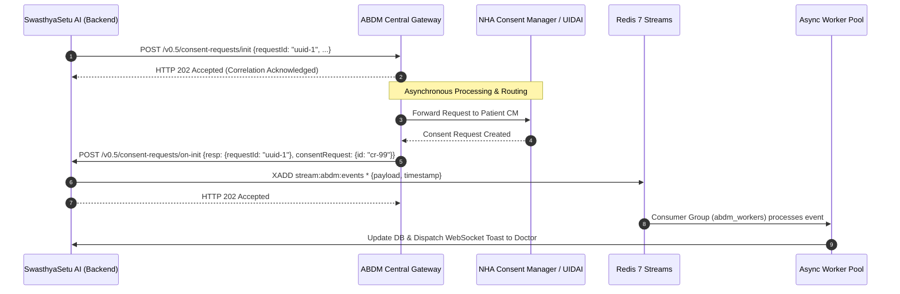
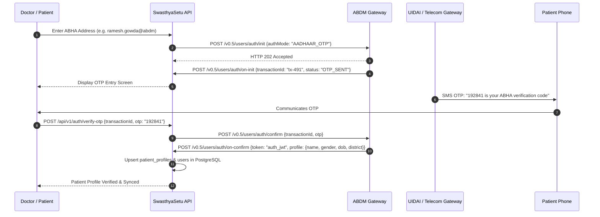
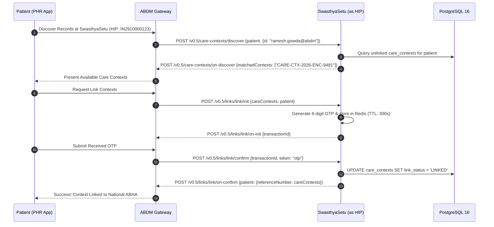
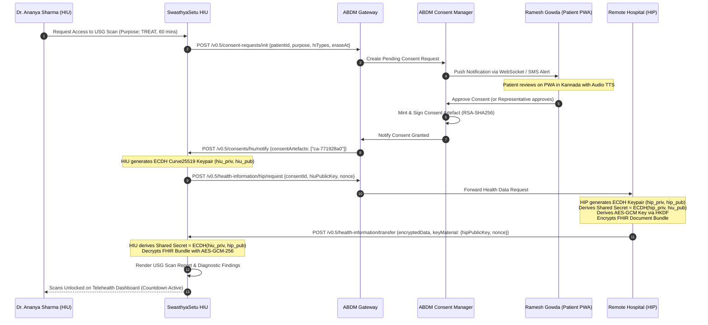
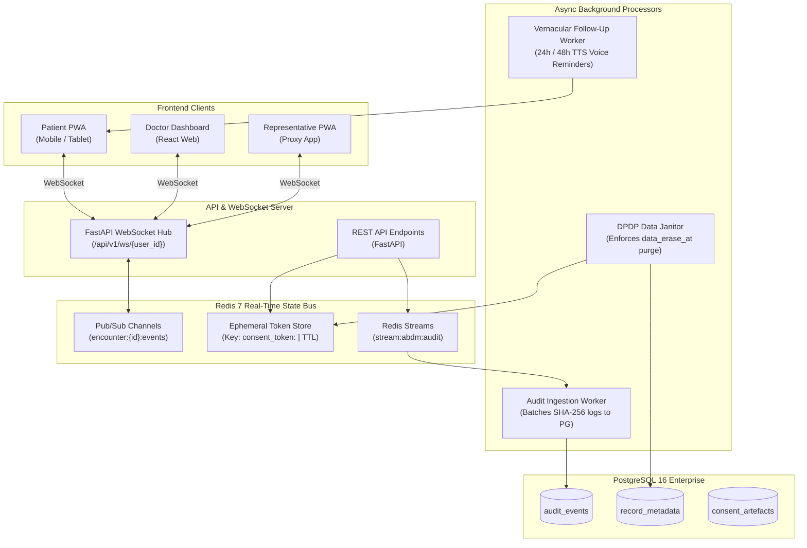

# ABDM Real-Time Pipelines, Gateway Async Architecture & Event Processing

**Document ID:** DATA-PIPE-SS-2026-V2  
**Project:** SwasthyaSetu AI (CareBridge India)  
**Standard:** ABDM Gateway v0.5 / v1.0 Asynchronous Callback Specification  
**Event Broker Stack:** Redis 7 (Streams + Pub/Sub + Ephemeral TTL Caches) + PostgreSQL 16 (Append-Only Event Store) + ARQ / Celery Async Workers

---

## 1. ABDM Gateway Asynchronous Callback Architecture

The National Health Authority (NHA) ABDM Gateway does **not** process healthcare transactions synchronously. All interactions between Health Information Users (HIU), Health Information Providers (HIP), and the Consent Manager (CM) follow an **asynchronous request-response webhook pattern**:

1. **Client Request (`POST /v0.5/...`):** SwasthyaSetu AI sends a request to the ABDM Gateway with a unique UUID `requestId` and timestamp.
2. **Immediate HTTP 202 Accepted:** The ABDM Gateway validates the authorization token, checks schema syntax, and responds immediately with `HTTP 202 Accepted` within $< 200\text{ms}$.
3. **Asynchronous Webhook Callback (`POST /v0.5/.../on-...`):** Once the target system (Consent Manager, UIDAI Aadhaar Server, or HIP) fulfills the operation, the Gateway invokes an asynchronous callback on SwasthyaSetu AI's webhook receiver. The response includes `resp.requestId` correlating directly to the original request.
4. **Idempotent Queueing via Redis Streams:** SwasthyaSetu AI places the callback payload into Redis Streams (`stream:abdm:events`) for decoupled, idempotent worker consumption.



---

## 2. End-to-End ABDM Milestone Sequence Flows

### 2.1 Milestone 1 (M1): ABHA Discovery & OTP Authentication Flow



---

### 2.2 Milestone 2 (M2): Care Context Discovery & OTP-Based Linking Flow



---

### 2.3 Milestone 3 (M3): Granular Consent, ECDH Key Exchange & Encrypted Data Transfer Flow



---

### 2.4 SwasthyaSetu AI Real-Time Telehealth State Engine (WebSockets + Redis Pub/Sub)



---

## 3. Redis Data Topologies & Schema Definitions

### 3.1 Ephemeral Access Grant Tokens
- **Key Pattern:** `consent_token:{grant_token_hash}`
- **Data Type:** String (JSON-encoded payload)
- **TTL:** Dynamically set to the exact remaining validity duration in seconds (e.g., $3600\text{s}$ for a 60-minute consultation).
- **Payload Schema:**
  ```json
  {
    "consent_id": "ca-771928a0-9481-42cb-b1b0",
    "patient_id": "ramesh-gowda",
    "doctor_id": "dr_ananya_sharma",
    "permitted_records": ["usg-kub-scan-9481", "blood-panel-oct2026"],
    "purpose": "TREAT",
    "scope": "read_only",
    "expires_at": "2026-10-19T11:45:00Z"
  }
  ```

### 3.2 Audit Log Queue (`stream:abdm:audit`)
- **Key:** `stream:abdm:audit`
- **Fields:**
  - `event_id`: UUIDv4
  - `actor_id`: Doctor, Patient, or System User ID
  - `action`: `ABDM_LINK_REQUEST`, `CONSENT_GRANTED`, `STREAM_ACCESS`
  - `resource_id`: Record ID or ABHA Address
  - `outcome`: `SUCCESS` or `DENIED`
  - `ip_hash`: SHA-256 hex string
  - `timestamp`: ISO-8601 UTC

---

## 4. Automated DPDP Act 2023 Data Erasure Pipeline

Under Section 8(7) of the Digital Personal Data Protection Act (DPDP Act 2023), healthcare data fiduciaries must not retain personal health data beyond the specific purpose and duration for which consent was granted.

### Erasure Lifecycle:
1. Every granted consent artefact has a deterministic `data_erase_at` timestamp.
2. A dedicated asynchronous worker (**DPDP Data Janitor**) executes every 60 seconds:
   - Queries `consent_requests WHERE status = 'GRANTED' AND data_erase_at <= NOW()`.
   - Purges all cached FHIR resources and decrypted binary files from memory, local caches, and temporary scratch volumes.
   - Deletes the corresponding Redis ephemeral token `consent_token:{hash}`.
   - Updates `consent_requests.status = 'EXPIRED'`.
   - Inserts an append-only audit event in `audit_events` with `action = 'DPDP_DATA_ERASE_EXECUTED'`.

---

## 5. Follow-Up Multilingual Voice Reminder Pipeline

To solve the 45%+ rural medication non-compliance problem:
1. When a consultation is marked `completed`, the backend enqueues two chronologically delayed reminder tasks in Redis:
   - **Task 1 ($T + 24\text{h}$):** Early medication tolerance and hydration check-in.
   - **Task 2 ($T + 48\text{h}$):** Symptom relief and red-flag triage assessment.
2. At the scheduled trigger time:
   - The worker looks up the patient's `preferred_language` (`kn` for Kannada, `hi` for Hindi).
   - Generates an interactive WhatsApp/SMS template containing both a vernacular text summary and a **one-click audio voice note link** (synthesized via Bhashini / Indian TTS).
   - If the patient presses or responds `[Need Doctor Help 🚨]`, the system immediately creates a priority triage ticket on Dr. Ananya's tele-clinic queue.

---

## 6. Clear Operational & Pipeline Deployment Instructions

### 6.1 Running the Async Event Workers
Start the background worker pool to consume Redis Streams and process ABDM callbacks:
```bash
# Terminal 1: Real-time ABDM Stream Worker
python -m app.workers.abdm_stream_worker --concurrency=4

# Terminal 2: DPDP Data Erasure & Follow-Up Cron Worker
python -m app.workers.janitor_and_reminders --interval=60
```

### 6.2 Idempotency & Gateway Retry Handling
The ABDM Gateway automatically retries callbacks on HTTP 5xx or network timeouts. To guarantee zero duplicate side-effects:
1. Check `SETNX abdm_idemp:{gateway_request_id} 1 EX 86400` in Redis before processing any callback.
2. If the key already exists, return `HTTP 200 OK` immediately without re-triggering notifications or database updates.
