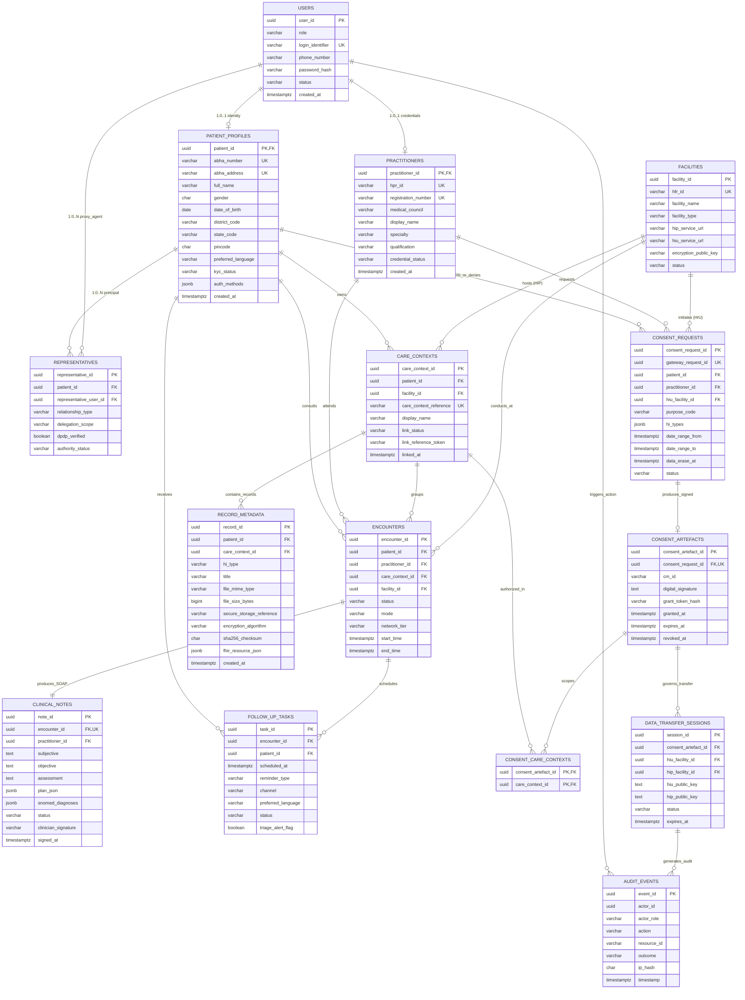

# Relational Database Schema & ABDM Data Architecture

**Document ID:** DATA-SCHEMA-SS-2026-V2  
**Target Engine:** PostgreSQL 16 Enterprise (Relational + JSONB with B-Tree & GIN Indexing)  
**ORM / Migration Engine:** SQLAlchemy 2.0 (AsyncIO) + Alembic  
**Compliance Standards:** Ayushman Bharat Digital Mission (ABDM M1, M2, M3), Digital Personal Data Protection Act (DPDP Act 2023), DISHA  
**Project:** SwasthyaSetu AI (CareBridge India)

---

## 1. ABDM Ecosystem & Data Architecture Overview

SwasthyaSetu AI implements the official National Health Authority (NHA) **Ayushman Bharat Digital Mission (ABDM)** specifications across all three integration milestones:

- **Milestone 1 (M1) — ABHA Identity & Registration:** Authoritative ABHA Number (14-digit numeric ID `XX-XXXX-XXXX-XXXX`), ABHA Address (`<handle>@<consent_manager_suffix>`, e.g., `ramesh.gowda@abdm`), Aadhaar / Mobile OTP KYC verification status, and Local Government Directory (LGD) demographic codes.
- **Milestone 2 (M2) — Care Context & Linking:** Decoupled clinical encounters organized into discrete **Care Contexts** under registered Health Information Providers (HIP). Care contexts are discovered and cryptographically linked to the patient's ABHA account via OTP verification tokens.
- **Milestone 3 (M3) — Consent Manager & Cryptographic Data Transfer:** Granular, purpose-bound, and time-expiring consent artefacts compliant with ISO/DISHA standards. Includes Elliptic Curve Diffie-Hellman (ECDH on Curve25519) session tracking for end-to-end encrypted FHIR bundle transfers between HIP and HIU.
- **DPDP Act 2023 Legal Alignment:** Distinct authorized representative proxy delegation model for dependent or elderly care, deterministic purpose limitation, and cryptographically enforced data erasure deadlines (`data_erase_at`).

---

## 2. Entity-Relationship Diagram (Mermaid ERD)



---

## 3. Production PostgreSQL 16 DDL

Below is the complete, idempotent, and battle-tested SQL definition including foreign keys, domain constraints, check constraints, partial indexes, and JSONB GIN indexes.

```sql
-- ============================================================================
-- SWASTHYASETU AI (CAREBRIDGE INDIA) — ABDM ENTERPRISE RELATIONAL SCHEMA
-- Target Engine: PostgreSQL 16+
-- Generated for ABDM M1, M2, M3 Compliance & DPDP Act 2023
-- ============================================================================

CREATE EXTENSION IF NOT EXISTS "pgcrypto";
CREATE EXTENSION IF NOT EXISTS "uuid-ossp";

-- ----------------------------------------------------------------------------
-- 1. USERS & SYSTEM AUTHENTICATION
-- Core identity credentials table supporting multi-tenant role-based access.
-- ----------------------------------------------------------------------------
CREATE TABLE users (
    user_id UUID PRIMARY KEY DEFAULT gen_random_uuid(),
    role VARCHAR(30) NOT NULL CHECK (role IN ('patient', 'practitioner', 'representative', 'admin', 'auditor')),
    login_identifier VARCHAR(100) UNIQUE NOT NULL, -- ABHA Number, HPR ID, or verified Mobile
    phone_number VARCHAR(20) NULL,
    password_hash VARCHAR(255) NOT NULL,
    status VARCHAR(20) NOT NULL DEFAULT 'active' CHECK (status IN ('active', 'suspended', 'deactivated')),
    created_at TIMESTAMPTZ NOT NULL DEFAULT CURRENT_TIMESTAMP,
    updated_at TIMESTAMPTZ NOT NULL DEFAULT CURRENT_TIMESTAMP
);

CREATE INDEX idx_users_phone ON users(phone_number) WHERE phone_number IS NOT NULL;
CREATE INDEX idx_users_role_status ON users(role, status);

-- ----------------------------------------------------------------------------
-- 2. PATIENT PROFILES (ABHA M1 SCHEMA)
-- Stores verified ABHA identities, demographic records, and KYC credentials.
-- ----------------------------------------------------------------------------
CREATE TABLE patient_profiles (
    patient_id UUID PRIMARY KEY REFERENCES users(user_id) ON DELETE CASCADE,
    -- Official ABDM 14-digit numeric format: XX-XXXX-XXXX-XXXX
    abha_number VARCHAR(17) UNIQUE NULL CHECK (abha_number ~ '^[0-9]{2}-[0-9]{4}-[0-9]{4}-[0-9]{4}$'),
    -- Official ABDM PHR handle format: username@abdm or username@sbx
    abha_address VARCHAR(100) UNIQUE NOT NULL CHECK (abha_address ~ '^[a-zA-Z0-9_.]{3,32}@[a-zA-Z0-9]{3,20}$'),
    full_name VARCHAR(150) NOT NULL,
    gender CHAR(1) NOT NULL CHECK (gender IN ('M', 'F', 'O')),
    date_of_birth DATE NULL,
    year_of_birth SMALLINT NOT NULL CHECK (year_of_birth BETWEEN 1900 AND 2100),
    month_of_birth SMALLINT NULL CHECK (month_of_birth BETWEEN 1 AND 12),
    day_of_birth SMALLINT NULL CHECK (day_of_birth BETWEEN 1 AND 31),
    
    -- Local Government Directory (LGD) standard demographic codes
    address_line TEXT NULL,
    district_code VARCHAR(10) NULL, -- LGD District Code
    district_name VARCHAR(100) NOT NULL DEFAULT 'Hassan',
    state_code VARCHAR(10) NULL,    -- LGD State Code
    state_name VARCHAR(100) NOT NULL DEFAULT 'Karnataka',
    pincode CHAR(6) NULL CHECK (pincode ~ '^[1-9][0-9]{5}$'),
    
    preferred_language VARCHAR(10) NOT NULL DEFAULT 'kn' CHECK (preferred_language IN ('kn', 'hi', 'en', 'ta', 'te')),
    
    -- ABDM KYC & Verification Attributes
    kyc_status VARCHAR(20) NOT NULL DEFAULT 'VERIFIED' CHECK (kyc_status IN ('VERIFIED', 'PENDING', 'FAILED')),
    aadhaar_verified BOOLEAN NOT NULL DEFAULT FALSE,
    aadhaar_last4 CHAR(4) NULL CHECK (aadhaar_last4 ~ '^[0-9]{4}$'),
    auth_methods JSONB NOT NULL DEFAULT '["AADHAAR_OTP", "MOBILE_OTP"]'::jsonb,
    profile_photo_ref VARCHAR(500) NULL, -- MinIO/S3 private URI
    
    created_at TIMESTAMPTZ NOT NULL DEFAULT CURRENT_TIMESTAMP,
    updated_at TIMESTAMPTZ NOT NULL DEFAULT CURRENT_TIMESTAMP
);

CREATE INDEX idx_patient_abha_address ON patient_profiles(abha_address);
CREATE INDEX idx_patient_abha_number ON patient_profiles(abha_number);
CREATE INDEX idx_patient_district_state ON patient_profiles(state_name, district_name);

-- ----------------------------------------------------------------------------
-- 3. HEALTHCARE PROFESSIONALS (HPR SCHEMA)
-- Stores verified doctor credentials, NMC registrations, and digital signatures.
-- ----------------------------------------------------------------------------
CREATE TABLE practitioners (
    practitioner_id UUID PRIMARY KEY REFERENCES users(user_id) ON DELETE CASCADE,
    -- ABDM Healthcare Professional Registry ID (e.g., dr_ananya@hpr.abdm)
    hpr_id VARCHAR(100) UNIQUE NULL,
    registration_number VARCHAR(50) UNIQUE NOT NULL, -- State Council / NMC Reg (e.g., KMC-581920)
    medical_council VARCHAR(100) NOT NULL DEFAULT 'National Medical Commission',
    registration_year SMALLINT NOT NULL DEFAULT 2018,
    display_name VARCHAR(150) NOT NULL,
    specialty VARCHAR(100) NOT NULL DEFAULT 'General Medicine',
    qualification VARCHAR(100) NOT NULL DEFAULT 'MBBS, MD',
    digital_signature_cert TEXT NULL, -- X.509 Certificate Public Key for prescription signing
    credential_status VARCHAR(20) NOT NULL DEFAULT 'verified' CHECK (credential_status IN ('verified', 'pending', 'suspended')),
    created_at TIMESTAMPTZ NOT NULL DEFAULT CURRENT_TIMESTAMP,
    updated_at TIMESTAMPTZ NOT NULL DEFAULT CURRENT_TIMESTAMP
);

CREATE INDEX idx_practitioners_reg_num ON practitioners(registration_number);
CREATE INDEX idx_practitioners_hpr_id ON practitioners(hpr_id);

-- ----------------------------------------------------------------------------
-- 4. HEALTH FACILITIES (HFR / HIP & HIU REGISTRY)
-- Stores registered hospitals, diagnostic clinics, and tele-health nodes.
-- ----------------------------------------------------------------------------
CREATE TABLE facilities (
    facility_id UUID PRIMARY KEY DEFAULT gen_random_uuid(),
    -- ABDM Health Facility Registry (HFR) unique identifier
    hfr_id VARCHAR(50) UNIQUE NOT NULL, -- e.g., IN2910000123
    facility_name VARCHAR(200) NOT NULL,
    facility_type VARCHAR(50) NOT NULL CHECK (facility_type IN ('CLINIC', 'HOSPITAL', 'DIAGNOSTIC_LAB', 'TELEHEALTH_NODE')),
    hip_service_url VARCHAR(255) NOT NULL, -- Gateway callback endpoint for HIP operations
    hiu_service_url VARCHAR(255) NOT NULL, -- Gateway callback endpoint for HIU operations
    encryption_public_key TEXT NOT NULL,   -- ECDH Curve25519 Public Key for health data exchange
    status VARCHAR(20) NOT NULL DEFAULT 'ACTIVE' CHECK (status IN ('ACTIVE', 'INACTIVE')),
    created_at TIMESTAMPTZ NOT NULL DEFAULT CURRENT_TIMESTAMP
);

CREATE INDEX idx_facilities_hfr_id ON facilities(hfr_id);

-- ----------------------------------------------------------------------------
-- 5. CARE CONTEXTS (ABDM M2 LINKING SCHEMA)
-- Discrete episodes of care under a HIP discovered and linked via OTP.
-- ----------------------------------------------------------------------------
CREATE TABLE care_contexts (
    care_context_id UUID PRIMARY KEY DEFAULT gen_random_uuid(),
    patient_id UUID NOT NULL REFERENCES patient_profiles(patient_id) ON DELETE RESTRICT,
    facility_id UUID NOT NULL REFERENCES facilities(facility_id) ON DELETE RESTRICT,
    -- External care context identifier exposed to ABDM Gateway (e.g., CARE-CTX-2026-ENC-9481)
    care_context_reference VARCHAR(100) UNIQUE NOT NULL,
    display_name VARCHAR(200) NOT NULL, -- e.g., "OPD Tele-Consultation - 19 Oct 2026"
    link_status VARCHAR(20) NOT NULL DEFAULT 'LINKED' CHECK (link_status IN ('DISCOVERED', 'OTP_INITIATED', 'LINKED', 'DELINKED')),
    link_reference_token VARCHAR(100) NULL, -- Ephemeral linking transaction reference
    linked_at TIMESTAMPTZ NOT NULL DEFAULT CURRENT_TIMESTAMP,
    created_at TIMESTAMPTZ NOT NULL DEFAULT CURRENT_TIMESTAMP
);

CREATE INDEX idx_care_contexts_patient ON care_contexts(patient_id);
CREATE INDEX idx_care_contexts_ref ON care_contexts(care_context_reference);

-- ----------------------------------------------------------------------------
-- 6. ENCOUNTERS & TELEHEALTH SESSIONS
-- Real-time clinical consultations, WebRTC network tracking, and diagnostic triage.
-- ----------------------------------------------------------------------------
CREATE TABLE encounters (
    encounter_id UUID PRIMARY KEY DEFAULT gen_random_uuid(),
    patient_id UUID NOT NULL REFERENCES patient_profiles(patient_id) ON DELETE RESTRICT,
    practitioner_id UUID NULL REFERENCES practitioners(practitioner_id) ON DELETE SET NULL,
    care_context_id UUID NULL REFERENCES care_contexts(care_context_id) ON DELETE SET NULL,
    facility_id UUID NULL REFERENCES facilities(facility_id) ON DELETE SET NULL,
    start_time TIMESTAMPTZ NOT NULL DEFAULT CURRENT_TIMESTAMP,
    end_time TIMESTAMPTZ NULL,
    mode VARCHAR(20) NOT NULL DEFAULT 'video' CHECK (mode IN ('video', 'audio', 'text_async')),
    network_tier VARCHAR(20) NOT NULL DEFAULT 'HD_VIDEO' CHECK (network_tier IN ('HD_VIDEO', 'AUDIO_ONLY', 'STORE_FORWARD')),
    status VARCHAR(20) NOT NULL DEFAULT 'queued' CHECK (status IN ('queued', 'in_progress', 'completed', 'cancelled')),
    symptoms_text TEXT NULL,
    allergies_json JSONB NOT NULL DEFAULT '[]'::jsonb,
    current_meds_json JSONB NOT NULL DEFAULT '[]'::jsonb,
    created_at TIMESTAMPTZ NOT NULL DEFAULT CURRENT_TIMESTAMP
);

CREATE INDEX idx_encounters_patient ON encounters(patient_id);
CREATE INDEX idx_encounters_status ON encounters(status);
CREATE INDEX idx_encounters_practitioner_date ON encounters(practitioner_id, start_time DESC);

-- ----------------------------------------------------------------------------
-- 7. CLINICAL NOTES (SOAP SCHEMA & CDSS GATE)
-- Structured clinical consultation notes, SNOMED/ICD diagnoses, and e-signatures.
-- ----------------------------------------------------------------------------
CREATE TABLE clinical_notes (
    note_id UUID PRIMARY KEY DEFAULT gen_random_uuid(),
    encounter_id UUID NOT NULL UNIQUE REFERENCES encounters(encounter_id) ON DELETE CASCADE,
    practitioner_id UUID NOT NULL REFERENCES practitioners(practitioner_id) ON DELETE RESTRICT,
    subjective TEXT NULL,
    objective TEXT NULL,
    assessment TEXT NULL,
    -- Structured prescription plan: { medications: [{ drug, dosage, frequency, duration, timing_icon }], advice, red_flags }
    plan_json JSONB NOT NULL DEFAULT '{"medications": []}'::jsonb,
    -- Standardized SNOMED CT and ICD-10 coded problem lists
    snomed_diagnoses JSONB NOT NULL DEFAULT '[]'::jsonb,
    icd10_codes JSONB NOT NULL DEFAULT '[]'::jsonb,
    status VARCHAR(30) NOT NULL DEFAULT 'draft' CHECK (status IN ('draft', 'clinician_approved', 'signed')),
    ddi_acknowledged BOOLEAN NOT NULL DEFAULT FALSE,
    clinician_signature TEXT NULL, -- Digital cryptographic signature hash
    signed_at TIMESTAMPTZ NULL,
    created_at TIMESTAMPTZ NOT NULL DEFAULT CURRENT_TIMESTAMP
);

CREATE INDEX idx_clinical_notes_encounter ON clinical_notes(encounter_id);
CREATE INDEX idx_clinical_notes_diagnoses_gin ON clinical_notes USING gin(snomed_diagnoses);

-- ----------------------------------------------------------------------------
-- 8. RECORD METADATA & HEALTH INFORMATION STORAGE (HIP VAULT)
-- Index of encrypted medical documents conforming to ABDM Health Information Types.
-- ----------------------------------------------------------------------------
CREATE TABLE record_metadata (
    record_id UUID PRIMARY KEY DEFAULT gen_random_uuid(),
    patient_id UUID NOT NULL REFERENCES patient_profiles(patient_id) ON DELETE RESTRICT,
    care_context_id UUID NOT NULL REFERENCES care_contexts(care_context_id) ON DELETE RESTRICT,
    -- Official ABDM Health Information Types (hiTypes)
    hi_type VARCHAR(50) NOT NULL CHECK (hi_type IN (
        'OPConsultation',
        'DiagnosticReport',
        'Prescription',
        'DischargeSummary',
        'ImmunizationRecord',
        'WellnessRecord',
        'HealthDocumentRecord'
    )),
    title VARCHAR(200) NOT NULL,
    date_str VARCHAR(50) NOT NULL DEFAULT '2026-10-19',
    file_mime_type VARCHAR(50) NOT NULL DEFAULT 'application/pdf',
    file_size_bytes BIGINT NOT NULL CHECK (file_size_bytes > 0),
    secure_storage_reference VARCHAR(500) NOT NULL, -- S3/MinIO private URI: vault/patients/{id}/...
    encryption_algorithm VARCHAR(50) NOT NULL DEFAULT 'AES-256-GCM',
    encryption_key_id VARCHAR(100) NOT NULL DEFAULT 'kms-carebridge-aes256-gcm',
    sha256_checksum CHAR(64) NOT NULL, -- Hex-encoded payload checksum for data integrity
    summary_findings TEXT NULL,
    raw_preview_text TEXT NULL,
    fhir_resource_json JSONB NULL, -- Structured HL7 FHIR R4 resource representation
    created_at TIMESTAMPTZ NOT NULL DEFAULT CURRENT_TIMESTAMP
);

CREATE INDEX idx_records_patient ON record_metadata(patient_id);
CREATE INDEX idx_records_care_context ON record_metadata(care_context_id);
CREATE INDEX idx_records_hi_type ON record_metadata(hi_type);
CREATE INDEX idx_records_fhir_gin ON record_metadata USING gin(fhir_resource_json);

-- ----------------------------------------------------------------------------
-- 9. CONSENT REQUESTS (ABDM M3 GATEWAY SCHEMA)
-- Initial request submitted to the ABDM Consent Manager by an HIU.
-- ----------------------------------------------------------------------------
CREATE TABLE consent_requests (
    consent_request_id UUID PRIMARY KEY DEFAULT gen_random_uuid(),
    -- ABDM Gateway UUID matching the requestId header
    gateway_request_id UUID UNIQUE NOT NULL,
    patient_id UUID NOT NULL REFERENCES patient_profiles(patient_id) ON DELETE RESTRICT,
    practitioner_id UUID NOT NULL REFERENCES practitioners(practitioner_id) ON DELETE RESTRICT,
    hiu_facility_id UUID NOT NULL REFERENCES facilities(facility_id) ON DELETE RESTRICT,
    
    -- Official NHA Purpose of Use codes (ActReason)
    purpose_code VARCHAR(30) NOT NULL CHECK (purpose_code IN ('CAREMGT', 'TREAT', 'PUBHLTH', 'CLINTR', 'DSRCH', 'PATRQT')),
    purpose_text VARCHAR(255) NOT NULL,
    
    -- Array of requested ABDM hiTypes
    hi_types JSONB NOT NULL DEFAULT '["OPConsultation", "DiagnosticReport", "Prescription"]'::jsonb,
    
    -- Temporal Boundaries for Clinical Records Query
    date_range_from TIMESTAMPTZ NOT NULL,
    date_range_to TIMESTAMPTZ NOT NULL,
    
    -- DPDP Act 2023 Mandatory Auto-Erasure Deadline
    data_erase_at TIMESTAMPTZ NOT NULL,
    
    access_mode VARCHAR(20) NOT NULL DEFAULT 'VIEW' CHECK (access_mode IN ('VIEW', 'STORE', 'STREAM', 'QUERY')),
    status VARCHAR(20) NOT NULL DEFAULT 'REQUESTED' CHECK (status IN ('REQUESTED', 'GRANTED', 'DENIED', 'REVOKED', 'EXPIRED')),
    
    created_at TIMESTAMPTZ NOT NULL DEFAULT CURRENT_TIMESTAMP,
    updated_at TIMESTAMPTZ NOT NULL DEFAULT CURRENT_TIMESTAMP
);

CREATE INDEX idx_consent_requests_patient ON consent_requests(patient_id);
CREATE INDEX idx_consent_requests_gateway ON consent_requests(gateway_request_id);
CREATE INDEX idx_consent_requests_erase ON consent_requests(data_erase_at) WHERE status = 'GRANTED';

-- ----------------------------------------------------------------------------
-- 10. CONSENT ARTEFACTS (ABDM M3 SIGNED ARTEFACT)
-- Cryptographically signed authorization issued by Consent Manager.
-- ----------------------------------------------------------------------------
CREATE TABLE consent_artefacts (
    consent_artefact_id UUID PRIMARY KEY DEFAULT gen_random_uuid(),
    consent_request_id UUID NOT NULL UNIQUE REFERENCES consent_requests(consent_request_id) ON DELETE CASCADE,
    cm_id VARCHAR(50) NOT NULL DEFAULT 'sbx', -- Consent Manager ID (e.g. 'abdm', 'sbx')
    
    -- Digital signature of the Consent Manager (RSA-SHA256 or ECDSA)
    digital_signature TEXT NOT NULL,
    grant_token_hash CHAR(64) NULL, -- SHA-256 hash of active ephemeral Redis token
    
    granted_at TIMESTAMPTZ NOT NULL DEFAULT CURRENT_TIMESTAMP,
    expires_at TIMESTAMPTZ NOT NULL,
    revoked_at TIMESTAMPTZ NULL,
    revocation_reason VARCHAR(255) NULL,
    created_at TIMESTAMPTZ NOT NULL DEFAULT CURRENT_TIMESTAMP
);

CREATE INDEX idx_consent_artefacts_expires ON consent_artefacts(expires_at);
CREATE INDEX idx_consent_artefacts_token ON consent_artefacts(grant_token_hash) WHERE grant_token_hash IS NOT NULL;

-- ----------------------------------------------------------------------------
-- 11. CONSENT CARE CONTEXTS (MANY-TO-MANY LINKAGE)
-- Explicit junction mapping which care contexts are scoped in a consent artefact.
-- ----------------------------------------------------------------------------
CREATE TABLE consent_care_contexts (
    consent_artefact_id UUID NOT NULL REFERENCES consent_artefacts(consent_artefact_id) ON DELETE CASCADE,
    care_context_id UUID NOT NULL REFERENCES care_contexts(care_context_id) ON DELETE RESTRICT,
    PRIMARY KEY (consent_artefact_id, care_context_id)
);

-- ----------------------------------------------------------------------------
-- 12. DATA TRANSFER SESSIONS (ABDM M3 ECDH ENCRYPTION)
-- Tracks end-to-end encrypted FHIR bundle data pushes between HIP and HIU.
-- ----------------------------------------------------------------------------
CREATE TABLE data_transfer_sessions (
    session_id UUID PRIMARY KEY DEFAULT gen_random_uuid(),
    consent_artefact_id UUID NOT NULL REFERENCES consent_artefacts(consent_artefact_id) ON DELETE RESTRICT,
    hiu_facility_id UUID NOT NULL REFERENCES facilities(facility_id) ON DELETE RESTRICT,
    hip_facility_id UUID NOT NULL REFERENCES facilities(facility_id) ON DELETE RESTRICT,
    
    -- ECDH Curve25519 Ephemeral Key Material
    hiu_public_key TEXT NOT NULL,
    hip_public_key TEXT NULL,
    hiu_nonce VARCHAR(64) NOT NULL,
    hip_nonce VARCHAR(64) NULL,
    
    status VARCHAR(20) NOT NULL DEFAULT 'REQUESTED' CHECK (status IN ('REQUESTED', 'TRANSFERRED', 'ACKNOWLEDGED', 'FAILED')),
    records_count INTEGER NOT NULL DEFAULT 0,
    expires_at TIMESTAMPTZ NOT NULL,
    created_at TIMESTAMPTZ NOT NULL DEFAULT CURRENT_TIMESTAMP
);

CREATE INDEX idx_data_transfer_consent ON data_transfer_sessions(consent_artefact_id);
CREATE INDEX idx_data_transfer_status ON data_transfer_sessions(status);

-- ----------------------------------------------------------------------------
-- 13. AUTHORIZED REPRESENTATIVES (DPDP ACT 2023 PROXY DELEGATION)
-- Legally binding proxy access for family members, guardians, and rural helpers.
-- ----------------------------------------------------------------------------
CREATE TABLE representatives (
    representative_id UUID PRIMARY KEY DEFAULT gen_random_uuid(),
    patient_id UUID NOT NULL REFERENCES patient_profiles(patient_id) ON DELETE CASCADE,
    representative_user_id UUID NOT NULL REFERENCES users(user_id) ON DELETE CASCADE,
    relationship_type VARCHAR(50) NOT NULL CHECK (relationship_type IN (
        'PARENT', 'SPOUSE', 'CHILD', 'DAUGHTER_IN_LAW', 'SON_IN_LAW', 'LEGAL_GUARDIAN', 'CAREGIVER'
    )),
    delegation_scope VARCHAR(50) NOT NULL DEFAULT 'FULL_PROXY' CHECK (delegation_scope IN (
        'FULL_PROXY', 'CONSENT_ONLY', 'VIEW_ONLY', 'EMERGENCY_ONLY'
    )),
    authorization_document_ref VARCHAR(500) NULL, -- S3 URI of legal power of attorney or DPDP self-attestation
    dpdp_verified BOOLEAN NOT NULL DEFAULT TRUE,
    authority_status VARCHAR(20) NOT NULL DEFAULT 'ACTIVE' CHECK (authority_status IN ('ACTIVE', 'SUSPENDED', 'REVOKED')),
    valid_until TIMESTAMPTZ NULL,
    created_at TIMESTAMPTZ NOT NULL DEFAULT CURRENT_TIMESTAMP
);

CREATE UNIQUE INDEX uq_patient_rep ON representatives(patient_id, representative_user_id) WHERE authority_status = 'ACTIVE';

-- ----------------------------------------------------------------------------
-- 14. AUDIT LOGS (IMMUTABLE DISHA & DPDP LOG TRAIL)
-- Tamper-evident trail of all ABHA queries, consent actions, and byte streaming.
-- ----------------------------------------------------------------------------
CREATE TABLE audit_events (
    event_id UUID PRIMARY KEY DEFAULT gen_random_uuid(),
    gateway_request_id UUID NULL, -- ABDM Gateway transaction correlation ID
    actor_id UUID NOT NULL,       -- User ID, Doctor ID, or System Agent
    actor_role VARCHAR(30) NOT NULL,
    action VARCHAR(60) NOT NULL,  -- e.g., 'CONSENT_REQUEST_INIT', 'CONSENT_GRANTED', 'STREAM_ACCESS'
    resource_id VARCHAR(150) NOT NULL, -- ABHA Address, Record ID, or Care Context ID
    purpose VARCHAR(255) NULL,
    outcome VARCHAR(20) NOT NULL CHECK (outcome IN ('SUCCESS', 'DENIED', 'EXPIRED', 'REVOKED', 'FAILED')),
    ip_hash CHAR(64) NOT NULL,    -- SHA-256 hashed IP for non-repudiation without raw PII leak
    user_agent VARCHAR(255) NULL,
    timestamp TIMESTAMPTZ NOT NULL DEFAULT CURRENT_TIMESTAMP
);

CREATE INDEX idx_audit_actor_time ON audit_events(actor_id, timestamp DESC);
CREATE INDEX idx_audit_action ON audit_events(action);
CREATE INDEX idx_audit_resource ON audit_events(resource_id);

-- ----------------------------------------------------------------------------
-- 15. FOLLOW-UP TASKS (AUTOMATED MULTILINGUAL VOICE / WHATSAPP REMINDERS)
-- Schedules 24h/48h post-consultation check-ins and priority triage alerts.
-- ----------------------------------------------------------------------------
CREATE TABLE follow_up_tasks (
    task_id UUID PRIMARY KEY DEFAULT gen_random_uuid(),
    encounter_id UUID NOT NULL REFERENCES encounters(encounter_id) ON DELETE CASCADE,
    patient_id UUID NOT NULL REFERENCES patient_profiles(patient_id) ON DELETE CASCADE,
    scheduled_at TIMESTAMPTZ NOT NULL,
    reminder_type VARCHAR(30) NOT NULL CHECK (reminder_type IN ('MEDICATION_CHECK', 'RED_FLAG_TRIAGE', 'POST_OP_SURVEY')),
    channel VARCHAR(20) NOT NULL DEFAULT 'WHATSAPP_VOICE' CHECK (channel IN ('WHATSAPP_VOICE', 'SMS_TEXT', 'APP_PUSH')),
    preferred_language VARCHAR(10) NOT NULL DEFAULT 'kn' CHECK (preferred_language IN ('kn', 'hi', 'en', 'ta', 'te')),
    status VARCHAR(20) NOT NULL DEFAULT 'PENDING' CHECK (status IN ('PENDING', 'SENT', 'DELIVERED', 'COMPLETED', 'FAILED')),
    patient_response TEXT NULL,
    triage_alert_flag BOOLEAN NOT NULL DEFAULT FALSE,
    dispatched_at TIMESTAMPTZ NULL,
    created_at TIMESTAMPTZ NOT NULL DEFAULT CURRENT_TIMESTAMP
);

CREATE INDEX idx_follow_up_scheduled ON follow_up_tasks(scheduled_at) WHERE status = 'PENDING';
CREATE INDEX idx_follow_up_patient ON follow_up_tasks(patient_id);
CREATE INDEX idx_follow_up_encounter ON follow_up_tasks(encounter_id);
```

---

## 4. Entity Relationships & Referential Integrity Matrix

| Parent Table | Child Table | Foreign Key Column | Cardinality | On Delete Behavior | Business Rationale |
| :--- | :--- | :--- | :--- | :--- | :--- |
| `users` | `patient_profiles` | `patient_id` | $1:0..1$ | `CASCADE` | Patient profile exists strictly as an extension of an authenticated user. |
| `users` | `practitioners` | `practitioner_id` | $1:0..1$ | `CASCADE` | Practitioner credentials directly link to the master user record. |
| `users` | `representatives` | `representative_user_id` | $1:0..N$ | `CASCADE` | Proxy agent identity is tied to an active system user account. |
| `patient_profiles` | `representatives` | `patient_id` | $1:0..N$ | `CASCADE` | A patient may authorize multiple representatives (e.g. spouse, child). |
| `patient_profiles` | `care_contexts` | `patient_id` | $1:0..N$ | `RESTRICT` | Cannot delete a patient profile if historic ABDM care contexts exist. |
| `facilities` | `care_contexts` | `facility_id` | $1:0..N$ | `RESTRICT` | Facilities hosting care contexts cannot be purged arbitrarily. |
| `care_contexts` | `record_metadata` | `care_context_id` | $1:0..N$ | `RESTRICT` | Encrypted medical records belong to a permanent care context bundle. |
| `patient_profiles` | `encounters` | `patient_id` | $1:0..N$ | `RESTRICT` | Preserves clinical encounter history for medico-legal audits. |
| `encounters` | `clinical_notes` | `encounter_id` | $1:1$ | `CASCADE` | One SOAP clinical note per clinical encounter. |
| `encounters` | `follow_up_tasks` | `encounter_id` | $1:0..N$ | `CASCADE` | Follow-up check-ins are scheduled directly from the clinical encounter. |
| `patient_profiles` | `follow_up_tasks` | `patient_id` | $1:0..N$ | `CASCADE` | Recipient patient for automated WhatsApp/SMS voice reminders. |
| `patient_profiles` | `consent_requests` | `patient_id` | $1:0..N$ | `RESTRICT` | All consent decisions must maintain non-repudiation auditability. |
| `consent_requests` | `consent_artefacts` | `consent_request_id` | $1:0..1$ | `CASCADE` | Signed artefact directly fulfills one gateway consent request. |
| `consent_artefacts` | `consent_care_contexts` | `consent_artefact_id` | $1:1..N$ | `CASCADE` | Scopes which care contexts are unlocked by the artefact. |
| `consent_artefacts` | `data_transfer_sessions`| `consent_artefact_id` | $1:0..N$ | `RESTRICT` | ECDH data transfer runs under the legal mandate of the artefact. |

---

### 4.2 ABDM Gateway API & Payload Attribute Crosswalk Matrix

The table below maps every database entity directly to its corresponding ABDM Gateway API endpoint, JSON request/response properties, and data flow direction:

| # | Database Entity | ABDM Milestone | Target ABDM Gateway API Endpoint | Gateway JSON Attributes $\leftrightarrow$ DB Columns | Flow Direction |
| :- | :--- | :--- | :--- | :--- | :--- |
| **1** | `users` | Auth / Base | `/v0.5/users/auth/init`<br>`/v0.5/sessions` | `authMode` $\leftrightarrow$ `users.role`<br>`authId` $\leftrightarrow$ `users.login_identifier` | Outbound Request |
| **2** | `patient_profiles` | M1 Identity | `/v0.5/users/auth/on-confirm`<br>`/v0.5/patients/profile/share` | `profile.healthIdNumber` $\leftrightarrow$ `abha_number`<br>`profile.healthId` $\leftrightarrow$ `abha_address`<br>`profile.name` $\leftrightarrow$ `full_name`<br>`profile.gender` $\leftrightarrow$ `gender`<br>`profile.yearOfBirth` $\leftrightarrow$ `year_of_birth`<br>`profile.address.district` $\leftrightarrow$ `district_name`<br>`profile.address.state` $\leftrightarrow$ `state_name`<br>`profile.address.pincode` $\leftrightarrow$ `pincode`<br>`profile.kycStatus` $\leftrightarrow$ `kyc_status` | Inbound Callback |
| **3** | `practitioners` | HPR Doctor | `/v0.5/hpr/on-search`<br>`/v0.5/hpr/profile` | `hprId` $\leftrightarrow$ `hpr_id`<br>`registrationNumber` $\leftrightarrow$ `registration_number`<br>`stateMedicalCouncil` $\leftrightarrow$ `medical_council`<br>`name` $\leftrightarrow$ `display_name`<br>`specialty` $\leftrightarrow$ `specialty`<br>`digitalSignatureCert` $\leftrightarrow$ `digital_signature_cert` | Inbound Verification |
| **4** | `facilities` | HFR Facility | `/v0.5/facilities/on-search`<br>`/v0.5/hip/on-register` | `facilityId` $\leftrightarrow$ `hfr_id`<br>`facilityName` $\leftrightarrow$ `facility_name`<br>`serviceUrl` $\leftrightarrow$ `hip_service_url`<br>`encryptionPublicKey` $\leftrightarrow$ `encryption_public_key` | Inbound Registry |
| **5** | `care_contexts` | M2 Linking | `/v0.5/care-contexts/discover`<br>`/v0.5/care-contexts/on-discover`<br>`/v0.5/links/link/on-confirm` | `patient.referenceNumber` $\leftrightarrow$ `patient_id`<br>`careContexts[].referenceNumber` $\leftrightarrow$ `care_context_reference`<br>`careContexts[].display` $\leftrightarrow$ `display_name`<br>`link.status` $\leftrightarrow$ `link_status` | Bidirectional Gateway Exchange |
| **6** | `encounters` | Telehealth | Internal Engine &<br>`/v0.5/care-contexts/discover` | `careContextReference` $\leftrightarrow$ `care_context_id`<br>`encounterId` $\leftrightarrow$ `encounter_id`<br>`networkTier` $\leftrightarrow$ `network_tier`<br>`status` $\leftrightarrow$ `status` | Local Tele-Consult & Gateway Reference |
| **7** | `clinical_notes` | M2 / Scribe | `/v0.5/health-information/transfer` | `Composition.section[].text` $\leftrightarrow$ `subjective`, `objective`, `assessment`<br>`Composition.section[medications]` $\leftrightarrow$ `plan_json`<br>`Composition.section[diagnoses]` $\leftrightarrow$ `snomed_diagnoses`, `icd10_codes`<br>`signature` $\leftrightarrow$ `clinician_signature` | Outbound Encrypted FHIR Bundle Entry |
| **8** | `record_metadata` | M2 / Vault | `/v0.5/health-information/transfer` | `hiTypes` $\leftrightarrow$ `hi_type`<br>`document.title` $\leftrightarrow$ `title`<br>`document.mimeType` $\leftrightarrow$ `file_mime_type`<br>`document.size` $\leftrightarrow$ `file_size_bytes`<br>`document.checksum` $\leftrightarrow$ `sha256_checksum`<br>`storageUri` $\leftrightarrow$ `secure_storage_reference` | Outbound Encrypted FHIR Bundle Entry |
| **9** | `consent_requests` | M3 Consent | `/v0.5/consent-requests/init`<br>`/v0.5/consent-requests/on-init` | `requestId` $\leftrightarrow$ `gateway_request_id`<br>`consent.patient.id` $\leftrightarrow$ `patient_id` (via `abha_address`)<br>`consent.purpose.code` $\leftrightarrow$ `purpose_code`<br>`consent.hiTypes` $\leftrightarrow$ `hi_types`<br>`consent.permission.dataEraseAt` $\leftrightarrow$ `data_erase_at`<br>`consent.permission.dateRange` $\leftrightarrow$ `date_range_from`, `date_range_to` | Outbound HIU Request & Gateway Callback |
| **10** | `consent_artefacts` | M3 Artefact | `/v0.5/consents/hiu/notify`<br>`/v0.5/consents/on-fetch` | `consentDetail.consentId` $\leftrightarrow$ `consent_artefact_id`<br>`consentDetail.consentManager.id` $\leftrightarrow$ `cm_id`<br>`signature` $\leftrightarrow$ `digital_signature`<br>`consentDetail.permission.dataEraseAt` $\leftrightarrow$ `expires_at` | Inbound Gateway Webhook |
| **11** | `consent_care_contexts` | M3 Scoping | `/v0.5/consents/on-fetch` | `consentDetail.careContexts[].careContextReference` $\leftrightarrow$ `care_context_id` | Inbound Gateway Webhook |
| **12** | `data_transfer_sessions` | M3 Crypto | `/v0.5/health-information/hip/request`<br>`/v0.5/health-information/transfer` | `transactionId` $\leftrightarrow$ `session_id`<br>`keyMaterial.dhPublicKey.keyValue` $\leftrightarrow$ `hiu_public_key`, `hip_public_key`<br>`keyMaterial.nonce` $\leftrightarrow$ `hiu_nonce`, `hip_nonce`<br>`status` $\leftrightarrow$ `status` | Bidirectional Encrypted Flow |
| **13** | `representatives` | DPDP Act 2023 | `/v0.5/consents/on-fetch`<br>DPDP Rule 4 Proxy API | `consentDetail.consentManager.representative` $\leftrightarrow$ `representative_user_id`<br>`relationshipType` $\leftrightarrow$ `relationship_type`<br>`delegationScope` $\leftrightarrow$ `delegation_scope` | Inbound Legal Attestation |
| **14** | `follow_up_tasks` | Vernacular Engine | Internal Cron &<br>Bhashini Indian Language TTS API | `scheduledAt` $\leftrightarrow$ `scheduled_at`<br>`languageCode` $\leftrightarrow$ `preferred_language`<br>`reminderType` $\leftrightarrow$ `reminder_type`<br>`triageAlert` $\leftrightarrow$ `triage_alert_flag` | Internal Async Event Worker |
| **15** | `audit_events` | DISHA / Audit | `/v0.5/...` Header Logging &<br>ABDM Audit Service | `requestId` $\leftrightarrow$ `gateway_request_id`<br>`actorId` $\leftrightarrow$ `actor_id`<br>`action` $\leftrightarrow$ `action`<br>`resourceId` $\leftrightarrow$ `resource_id`<br>`outcome` $\leftrightarrow$ `outcome`<br>`ipHash` $\leftrightarrow$ `ip_hash`<br>`timestamp` $\leftrightarrow$ `timestamp` | Internal Immutable Append-Only Log |

---

## 5. Clear Implementation & Migration Instructions

### 5.1 SQLAlchemy 2.0 Async Migration Guide
To align backend ORM models with this official schema:
1. Ensure the PostgreSQL connection string uses `postgresql+asyncpg://`.
2. Generate an Alembic revision:
   ```bash
   alembic revision --autogenerate -m "align_schema_with_abdm_m1_m2_m3"
   alembic upgrade head
   ```
3. Verify that all UUID primary keys are handled via Python `uuid.uuid4` defaults or PostgreSQL `gen_random_uuid()`.

### 5.2 ABDM Data Validation Rules
- **ABHA Address Validation:** Strictly reject strings that do not contain an `@` suffix or contain forbidden characters. Valid: `ramesh.gowda@abdm`, `kavita.rao@sbx`.
- **ABHA Number Validation:** Validate 14 digits with hyphens (`^\d{2}-\d{4}-\d{4}-\d{4}$`).
- **Data Erasure Job:** Configure a continuous background worker (every 10 minutes) querying `consent_requests WHERE status = 'GRANTED' AND data_erase_at <= NOW()` to purge cached records from memory and local databases in accordance with DPDP Act 2023.
