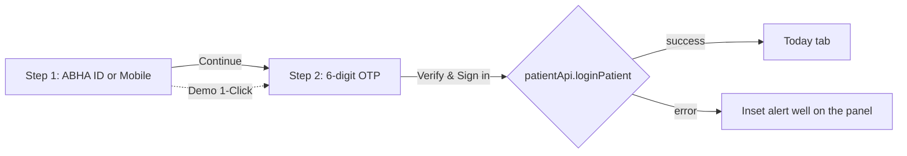
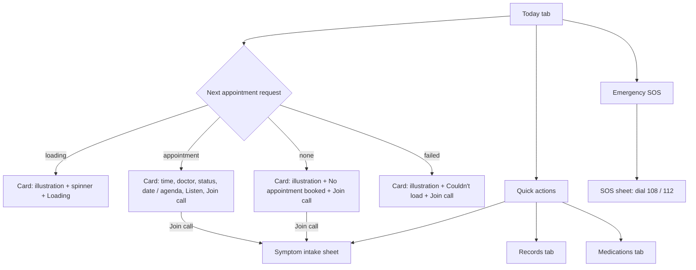
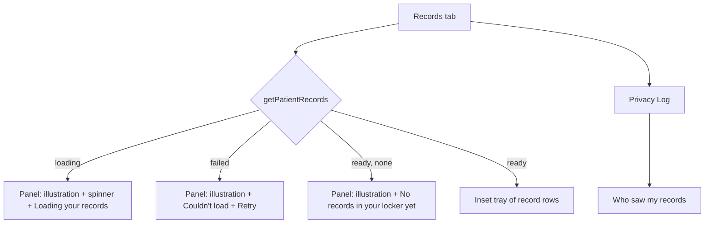
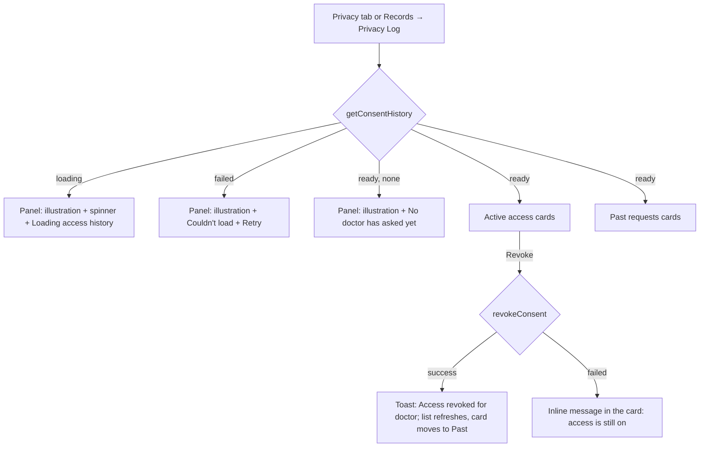
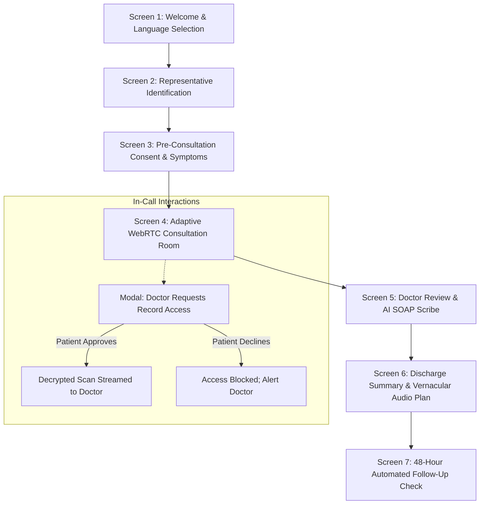

# Screen-by-Screen User Journey Flows & Interaction Specifications

**Document ID:** UI-FLOWS-CB-2026-V1  
**Project:** CareBridge India  
**Scope:** Complete User Journeys, Modal States, and Error Handlers  

---

## 0. Patient App (Expo) — Current Screens

> This section tracks the screens as built in `frontend Patient/` with the Harbor Calm design system ([design_system_tokens.md](design_system_tokens.md), [design_principles.md](design_principles.md)). Sections 1–2 below are the earlier conceptual journey and are kept for reference. Screens are updated here one at a time as they are restyled.

### 0.1 Sign in (`PatientLoginView.tsx`)

| Area | What the patient sees | Component / depth |
|---|---|---|
| Top bar | Brand mark + "SwasthyaSetu / Patient App"; language pill (ಕನ್ನಡ · हिंदी · English) | `BrandMark`; raised `NeuPressable` pill |
| Hero | Shield-and-leaves illustration, one serif headline, **ABDM** (gold, verified) and **DPDP 2023** badges | `LoginHero` SVG; `Badge solid` (opaque base over the ambient blobs) |
| Title | "Sign in" + one-line instruction + **Listen** | `AudioListenButton` (raised, audio badge colours); reads headline, description, instructions and trust marks |
| Progress | ID → OTP stepper: current step raised disc + bold label, done step shows a success check | `Stepper` |
| Trust | Only you decide · Never shared · Govt health ID | Inset `IconDisc` (informational) |
| Mode | ABHA ID / Mobile | `SegmentedControl` (inset track, raised thumb; short labels, never truncated) |
| Fields | ABHA address or mobile; OTP (after Continue) | `TextField` strong inset, leading icon, focus ring; OTP large centred digits |
| Actions | Continue with ABHA → Verify & Sign in; Demo 1-Click | `PrimaryButton` (raised, primary label); `SecondaryButton` |

States:
- **Loading:** primary button shows a spinner **and** "Signing in…" (button disabled).
- **Error:** soft inset alert well above the mode switch, always a translated message (raw browser / server text is never shown; it is logged with `console.warn` in development only):
  - **Can't connect** (no response: offline, server down): warningDeep signal icon, "Can't connect. Check your internet and try again."
  - **Rejected** (server answered and refused): dangerDeep alert icon, "Login failed. Please check your details."
  - Both are previewable in en / kn / hi in the dev Style Guide ("Sign-in errors").
- **Empty:** not applicable (fields are pre-filled with demo data).

Accessibility: the stepper is announced as a progress bar ("step 2 of 2, OTP"); all touch targets ≥ 48; text ≥ 4.5:1 including over the ambient background; verified at 320 px width in en / kn / hi with no horizontal scroll.

### 0.2 Today / Home (`HomeView.tsx`, `HeroAppointmentCard.tsx`, `TactileGrid.tsx`, `PatientHeader.tsx`)

| Area | What the patient sees | Component / depth |
|---|---|---|
| Glass toolbar | Brand mark + name / subtitle (width-dependent), raised language pill (full or short), raised avatar disc (opens symptom intake), raised sign-out disc | `PatientHeader` / `HeaderBar` on `GlassToolbar` |
| Greeting | Localised date + serif "Namaste, Ramesh" | `AppText` on the canvas |
| Next appointment | One-line serif time + small zone, doctor photo in an inset frame, doctor + clinic, computed **when** badge (+ Rescheduled / New time), localised date and expandable agenda as inset icon rows, **Listen**, **Join call** | Soft raised `NeuPanel`, `IconDisc` inset, `Badge`, `AudioListenButton`, `CriticalButton` (primary) |
| Quick actions | My Doctors · My Records · Medicines · Follow-up, each a raised tile with a raised icon disc; tiles in a row share one height | `MetricCard` (tappable, presses to inset) |
| Emergency | Emergency SOS · Ambulance 108 / 112 | `CriticalButton` (danger) |
| Trust | ABDM (gold, verified) and DPDP 2023 badges; the full compliance sentence is the screen-reader label | `Badge solid` |
| Tab bar | Floating glass pill; active tab = raised disc + bold label | `GlassTabBar` |

States of the appointment card (driven by a display-only `appointmentStatus` in `App.tsx`; the request itself is unchanged): **loading** (spinner + "Loading…"), **appointment**, **none** ("No appointment booked" + queue hint), **failed** (warning icon + "Couldn't load your appointment."). All four keep the Join call action and use the `EmptyAppointments` illustration when there is no appointment. A live reschedule over WebSocket updates the card and shows the Rescheduled / New time badges.

Listen reads: "Your next appointment is at {time}, {date}, with {doctor}." + clinic + the full agenda.

**Review fixes (display only):**
- **Header:** brand group takes the remaining width and ellipsizes; controls never shrink or overlap it. By effective width (screen width ÷ font scale): ≥ 400 full language name; < 400 short pill (EN / ಕನ್ನಡ / हिं); subtitle shown from 380, app name from 370, brand mark only below that.
- **Greeting date:** full weekday + month in the app language ("रविवार, 25 अक्टूबर", "ಭಾನುವಾರ, 25 ಅಕ್ಟೋಬರ್") from translated tables (no reliance on device Intl data).
- **Time:** "10:30 AM" on one line in Fraunces (every language), shrinks rather than wraps; the zone ("IST") is a smaller suffix.
- **When badge:** computed on the device from the parsed date / time in IST calendar days: Today · Tomorrow · In N days, or a neutral **Past appointment · N days ago** (also for earlier today once the start time has passed). Shown next to the Rescheduled / New time badges when flagged. The backend's `relativeTime` is used only when the date cannot be parsed (to-do in `docs/API_ROUTES.md` § 24).
- **Date row:** the parsed date as a full localised date ("शुक्रवार, 23 अक्टूबर 2026"); unparsable labels are shown as sent.
- **Agenda:** up to 3 lines, then a translated **Read more / Show less** toggle (only when the text is longer); Listen reads the full agenda.
- **Tiles:** English captions shortened to avoid broken or orphaned lines ("Video consult", "Recovery update"; the bundled fonts have no non-breaking hyphen glyph).
- **Mixed script:** names, dates, times, clinic and agenda from the backend keep Latin letters / digits in DM Sans (Fraunces for the time and the greeting name) on kn / hi screens.
- Join call behaviour and enablement are unchanged (see the decisions listed in `docs/API_ROUTES.md` § 24).

Checked on web: en / kn / hi at 320, 360, 372, 390 and 430 px: no header overlap, no clipped brand, no horizontal scroll, time on one line, Read more present for long agendas. Large system font cannot be simulated on web; the header logic accounts for font scale and the Style Guide previews the 1.3× case.

Style Guide (dev build, long-press the brand mark) previews every fix: header at 320 / 360 / 390 / 430 px and 1.3× font scale; the time; each when-badge state against a fixed "now"; collapsed and expanded agenda; mixed-script samples and Indic eyebrows; and the greeting date with the four quick-action tiles in en / kn / hi at 320 px.

Note: doctor, clinic and agenda text come from the backend in English and are shown as received (in the Latin font).

### 0.3 Health Records (`RecordsLockerView.tsx`)

| Area | What the patient sees | Component / depth |
|---|---|---|
| Nav | Back to Home; **Privacy Log** | `NavBar`, `SecondaryButton` |
| Header | Records icon, title, subtitle; FHIR R4 Encrypted badge, plus Shared / Locked counts once loaded | `ScreenHeader`, `Badge` |
| Filter | All · Imaging · Lab | `SegmentedControl` (inset track, raised thumb) |
| Records | One row per record: inset icon disc (green when shared), title, category • date, facility, one-word status badge (**Shared** / **Locked**), time left on the consent, "{doctor} can view", file size | Read-only rows in one soft inset tray (`NeuList variant="tray"` + `ListRow`), grooves between rows |
| Security note | Lock disc + encryption title and one sentence | `Card` (soft raised) with inset `IconDisc` |

States: **loading**, **error** (warningDeep network icon + Retry, which reloads), **empty locker** and **empty filter** use different sentences; all four show the `EmptyRecords` illustration in a raised panel (so Retry is never inside an inset). The time-left badge shows minutes under an hour, then whole hours.

### 0.4 Privacy / Who saw my records (`WhoSawMyRecordsView.tsx`)

| Area | What the patient sees | Component / depth |
|---|---|---|
| Nav | Back to Home or Records (whichever opened it) | `NavBar` |
| Header | Shield icon, "Privacy Report", plain subtitle ("Who asked to see your records, and why"); DPDP 2023 badge, plus "{n} active" once loaded | `ScreenHeader`, `Badge` |
| Active access | One card per consent still on: doctor avatar, name, reg no • facility, **Active** badge; record + purpose in an inset well; date / time and a time-left badge; **Listen**; **Revoke Access** | `Card` (soft raised) › `Well`, `Badge`, `AudioListenButton`, `CriticalButton` (danger) |
| Past requests | Same card without Revoke; one-word status badge with icon (Pending · Expired · Revoked · Declined) and the longer status line | `Card`, `Badge` |
| Notice | Shield disc, "Your Data. Your Control.", DPDP Section 6 sentence | `Card` (soft raised) with inset `IconDisc` |

States: **loading**, **error** (warningDeep network icon + Retry), **empty**; all three use the `EmptyAccessLog` illustration in a raised panel. **Revoking:** the button shows a spinner and is disabled. **Revoke failed:** a translated message inside that card, never raw server text (logged with `console.warn` in development only): *Can't connect* (warningDeep network icon) or *Could not revoke* (dangerDeep), both saying access is still on. **Revoked:** success toast, the list refreshes in place without a loading flash.

Listen reads: "{doctor}, {facility}. {status}. Record: {record}. Purpose: {purpose}. {time left}."

Style Guide (dev build) previews five cards (two active, revoked, expired, declined with no facility); Revoke there fails on purpose (offline / rejected) so both error messages can be checked in en / kn / hi.

---

## 1. Master Screen Flowchart

---

## 2. Detailed Screen Specifications

### Screen 1: Welcome & Language Selection
- **Hero Banner:** *"CareBridge India — ಸುಲಭ, ಸುರಕ್ಷಿತ ಆರೋಗ್ಯ ಸೇವೆ"*
- **Language Chips:** Large, thumb-friendly buttons: `[ಕನ್ನಡ (Kannada)]`, `[हिन्दी (Hindi)]`, `[English]`.
- **Audio Affordance:** Prominent green pill: `🔊 Listen to instructions in selected tongue`.

### Screen 2: Representative Authority Check
- **Toggle Options:**
  - `(o) I am the patient (ನಾನೇ ರೋಗಿ)`
  - `( ) I am an authorised representative (ಅಧಿಕೃತ ಪ್ರತಿನಿಧಿ)`
- If Representative:
  - Input field for Representative Name & Relationship dropdown (`Daughter/Son`, `Spouse`, `Legal Guardian`).

### Screen 3: Pre-Consultation Consent & Records
- Displays consultation scope and data minimization summary.
- List of ABDM-linked health records with individual status badges (`🔒 Protected`).

### Screen 4: Adaptive Telehealth Room
- Top network status badge:
  - 🟢 `Good Network (HD Video 450 kbps)`
  - 🟡 `Weak Network (Audio Priority 50 kbps)`
  - 🔴 `Store & Forward Async (<20 kbps)`
- In-call controls: Mic Mute, Video Toggle, End Call.

### Screen 5: Purpose-Specific Consent Modal
- High-priority modal overlay:
  - Doctor Name & Medical Registration Number.
  - Requested Record Title (e.g. *Ultrasound Pelvis & Abdomen*).
  - Explicit Clinical Purpose (e.g. *Evaluating suspected renal calculus*).
  - Auto-Expiry Timer: *60 minutes*.
  - Big action buttons: `[ ❌ Decline (ತಿರಸ್ಕರಿಸಿ) ]` vs. `[ ✅ Approve (ಅನುಮೋದಿಸಿ) ]`.

### Screen 6: Patient Discharge Plan
- Prescribed medications with dosage iconography (morning ☀️, afternoon 🌤️, night 🌙).
- Audio button: Plays Kannada/Hindi speech synthesis of complete doctor instructions.
- 48-hour follow-up response card: `[Feeling Better 😊]`, `[No Change 😐]`, `[Need Help 🚨]`.
