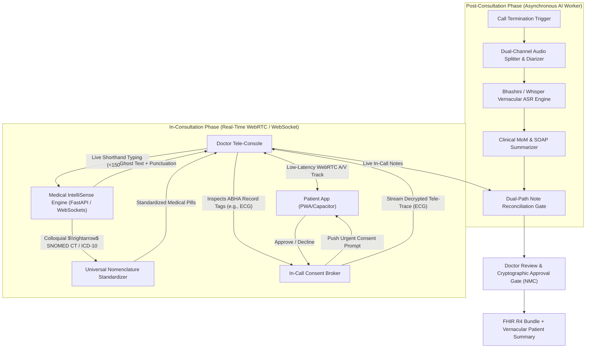
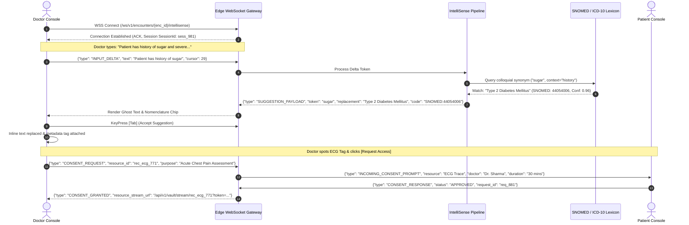
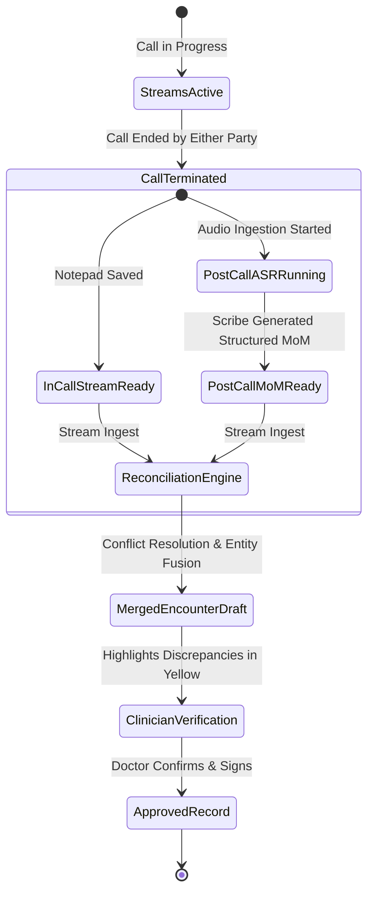

# Dual Consultation Documentation Architecture & IntelliSense Pipeline

**Document ID:** FEAT-INTELLISENSE-CB-2026-V1  
**Project:** CareBridge India (SwasthyaSetu AI)  
**Scope:** Dual-Path Clinical Consultation Documentation, Real-Time IntelliSense & In-Call Data Flow  
**Version:** 1.0.0 (Production Architecture)

---

## 1. Executive Overview

Clinical tele-consultations require rapid, accurate, and legally defensible documentation without disrupting doctor-patient rapport. Contemporary EHR systems force doctors to split their attention between looking at the patient and manually typing verbatim notes into rigid dropdown menus.

CareBridge India's **Consultation Documentation Engine** introduces a synchronized **Dual-Path Architecture**:

1. **Path A — In-Consultation Real-Time Medical IntelliSense:**  
   An intelligent, latency-optimized clinical notepad within the doctor's tele-consultation dashboard. As the clinician types shorthand notes during the call, an edge-assisted AI IntelliSense engine performs:
   - Keystroke-level clinical auto-completion (tab-to-complete ghost text).
   - Real-time medical spell-checking and structured clinical punctuation.
   - **Colloquial-to-Universal Nomenclature Standardization** (e.g., local vernacular and lay terms like *"sugar"* $\rightarrow$ *"Type 2 Diabetes Mellitus"*, or *"heart attack"* $\rightarrow$ *"Acute Myocardial Infarction"*).
   - Dynamic in-call ABHA record tag discovery with one-click patient consent triggers.

2. **Path B — Post-Consultation Ambient Meeting Minutes (MoM) Scribe:**  
   Once the audio/video call concludes, the recorded multi-party audio transcript is processed asynchronously by the ambient AI Scribe pipeline to generate comprehensive, structured Clinical Minutes of Meeting (MoM) and draft SOAP notes, which are then reconciled with the doctor's live notepad entries for final verification.



---

## 2. Real-Time Tele-Consultation Console Layout

The Doctor Tele-Console is designed as an ergonomic three-pane workspace allowing the physician to maintain eye contact with the patient while viewing medical indicators and jotting down standardized notes.

```
+-------------------------------------------------------------------------------------------------------------------------+
| CAREBRIDGE CLINICIAN CONSOLE — Encounter #ENC-2026-9481                      [🟢 4G Adaptive WebRTC | Latency: 42ms]    |
+---------------------------------------------------------+---------------------------------------------------------------+
| PANEL 1: PATIENT HUD & AV STREAM (45% Width)            | PANEL 2: INTELLISENSE CLINICAL NOTEPAD (55% Width)            |
|                                                         |                                                               |
| +-----------------------------------------------------+ | [ 📝 Real-Time Notepad ] [ 📋 SOAP Format ] [ 💊 Rx Builder ]   |
| |                                                     | |-------------------------------------------------------------|
| |             LIVE WEBRTC VIDEO / AUDIO               | | CHIEF COMPLAINTS & HISTORY:                                 |
| |                Ramesh Gowda (54M)                   | | Patient presents with c/o severe chest pain radiating to     |
| |                                                     | | left arm since 2 hrs. History of [sugar]                     |
| | [ Mic: Active ] [ Cam: HD ] [ Signal: Excellent ]   | |                                      |                      |
| +-----------------------------------------------------+ |                                      v (IntelliSense Prompt)  |
|                                                         | |                             +-----------------------------+ |
| PATIENT ABHA HEALTH RECORD MANIFEST:                    | |                             | 💡 Suggestion:              | |
| [ ABHA ID: 91-8842-1920-4412 ]                          | |                             | Type 2 Diabetes Mellitus    | |
| Available Records:                                      | |                             | [SNOMED: 44054006] (Tab ↹)  | |
|  • [Tag: ECG Trace (Oct 18, 2026)] 🔒 [Request Access]  | |                             | Fasting Blood Glucose (Esc) | |
|  • [Tag: Lipid Profile (Sep 2026)] 🔒 [Request Access]  | |                             +-----------------------------+ |
|  • [Tag: Discharge Summary 2024]   🔒 [Request Access]  | | Past history of [heart attack] in 2022.                     |
|                                                         | |                       |                                     |
| IN-CALL CONSENT STATUS:                                 | |                       v                                     |
| [⚡ Requested ECG Access] -> ⏳ Patient Reviewing Prompt | |      Converted: [Acute Myocardial Infarction | ICD-10: I21.9] |
|                                                         | |                                                             |
| +-----------------------------------------------------+ | CLINICAL FINDINGS & VITALS:                                   |
| | IN-CALL RECORD VIEWER (Triggered upon Approval)     | | BP: 154/96 mmHg | Pulse: 104 bpm | SpO2: 96% on room air    |
| | [ 🫀 ECG Lead II Waveform rendering live... ]        | |                                                             |
| +-----------------------------------------------------+ | [ Save Draft ] [ Request Review ] [ Generate Final Rx ]       |
+---------------------------------------------------------+---------------------------------------------------------------+
```

---

## 3. End-to-End Latency Budgets & WebSocket Architecture

Real-time typing feedback must feel instantaneous to prevent cognitive distraction for the physician. The system enforces strict performance bounds across every tier:

| Operation | Target Latency | Upper Bound SLA | Fallback Strategy |
| :--- | :--- | :--- | :--- |
| **Keystroke Debounce** | 80 ms | 120 ms | Local browser cache evaluation |
| **WebSocket Round-Trip (RTT)** | 25 ms | 50 ms | Edge WebSocket gateway on regional CDN |
| **Trie / Vocabulary Prefix Search** | 5 ms | 15 ms | In-memory Redis Trie & Local IndexedDB |
| **Nomenclature Mapping (SLM/NER)**| 40 ms | 90 ms | Heuristic dictionary lookup followed by async SLM validation |
| **Total Ghost Text Rendering SLA** | **< 150 ms** | **250 ms** | Graceful degradation to local dictionary completion |

### WebSocket Framing Protocol

The client communicates with the `FastAPI IntelliSense Worker` over an authenticated, persistent binary/JSON WebSocket connection:



---

## 4. Dual-Path Reconciliation Strategy

When the call terminates, two distinct documentation streams exist:
1. **Live Notepad Stream:** High fidelity on clinical decisions, exact medication dosages, and specific physical exam observations recorded directly by the physician.
2. **Post-Call Audio Scribe Stream:** Rich vernacular context, timeline of symptoms described by the patient, and colloquial discussions picked up by the speech-to-text pipeline.



### Conflict Resolution Hierarchy
1. **Dosages and Prescriptions:** The Doctor's live notepad entry always takes precedence over acoustic speech recognition to avoid phonetically similar drug errors (e.g., *Cetirizine* vs *Cinnarizine*).
2. **Patient Reported History:** The Post-Call MoM Scribe supplements any omissions in the live notepad (e.g., symptom onset details stated verbally but unwritten by the doctor).
3. **Explicit Discrepancy Highlighting:** If the post-call scribe detects an allergy mention (e.g., *"Patient states penicillin allergy"*), but the doctor typed an antibiotic prescription for *Amoxicillin*, the reconciliation engine generates an **Urgent Safety Alert** before permitting note closure.
