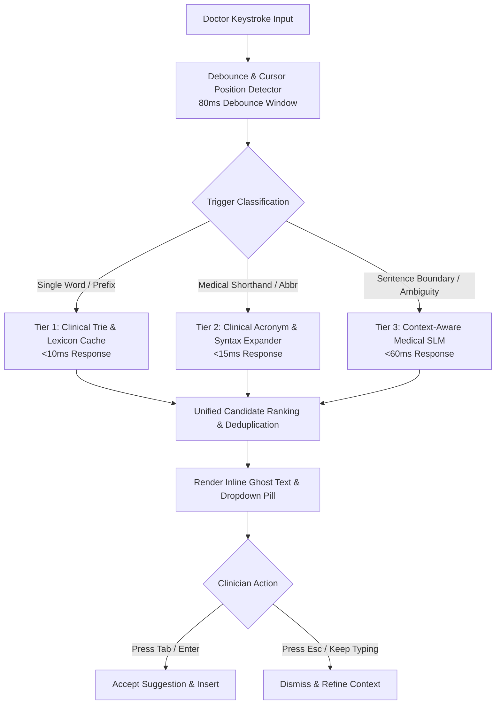

# Real-Time Clinical IntelliSense Engine & Predictive Autocomplete

**Document ID:** FEAT-INTELLISENSE-ENGINE-2026-V1  
**Project:** CareBridge India (SwasthyaSetu AI)  
**Scope:** Real-Time Tokenization, Medical Autocomplete, Shorthand Expansion & Clinical Punctuation  
**Version:** 1.0.0 (Production Blueprint)

---

## 1. Engine Core Overview

The Real-Time Clinical IntelliSense Engine operates directly behind the doctor's consultation notepad. Unlike generic text completion engines (which prioritize conversational or email phrasing), this engine is fine-tuned specifically for clinical syntax, diagnostic criteria, pharmaceutical abbreviations, and rapid shorthand documentation.



---

## 2. Multi-Tier Completion Architecture

To satisfy the strict `<150ms` end-to-end rendering budget while avoiding CPU throttling on standard clinic computers, the engine utilizes a three-tier cascaded architecture:

### Tier 1: Client-Side In-Memory Radix Trie (Local Cache)
- **Scope:** 25,000 most common Indian generic and brand pharmaceuticals, anatomical sites, and common clinical adjectives.
- **Latency:** `< 5ms` execution time inside the browser's Web Worker.
- **Mechanism:** Prefix matching on word boundaries (`c/o` $\rightarrow$ *"complains of"*, `parac` $\rightarrow$ *"Paracetamol 650mg"*).

### Tier 2: Deterministic Clinical Shorthand Expansion
Doctors frequently write extreme shorthand during live calls. Tier 2 uses deterministic medical transformation rules:

| Doctor Shorthand | IntelliSense Expansion | Semantic Category |
| :--- | :--- | :--- |
| `c/o cst pn x 2d` | *"Complaining of chest pain for 2 days"* | History of Present Illness |
| `h/o htn, dm2` | *"History of Hypertension and Type 2 Diabetes Mellitus"* | Past Medical History |
| `o/e per abd s/s` | *"On examination: Per abdomen soft and non-tender"* | Objective Physical Exam |
| `afeb, vitals stbl` | *"Patient is afebrile; baseline vitals are stable"* | Physical Signs |
| `sos pcm 650 tid pc` | *"Tab. Paracetamol 650mg, thrice daily after meals as needed"* | Prescription / Plan |
| `r/o dka` | *"Rule out Diabetic Ketoacidosis"* | Differential Assessment |

### Tier 3: Context-Aware Medical Small Language Model (SLM)
When the prompt involves complex diagnostic phrasing or context-dependent clinical reasoning, the prompt is evaluated by an optimized on-premise/edge Small Language Model (e.g., Med-Gemma-2B quantized via TensorRT-LLM / ONNX Runtime).
- **Latency:** ~45-65ms on edge server.
- **Context Window:** Last 120 words of the current encounter note + patient age/gender context from the encounter metadata.

---

## 3. Real-Time Clinical Punctuation & Sentence Formatting

Physicians typing at high speed often omit capitalization, periods, colons, and structured list formatting. The engine features an **Intelligent Auto-Punctuation Parser**:

### 3.1 Sentence Boundary Detection
```typescript
interface AutoPunctuationRule {
  pattern: RegExp;
  replacement: string;
  category: "vitals" | "symptoms" | "medications" | "formatting";
}

export const CLINICAL_PUNCTUATION_RULES: AutoPunctuationRule[] = [
  // Auto-format vitals strings
  {
    pattern: /\b(?:bp|blood pressure)\s*[:=]?\s*(\d{2,3})[\/\s](\d{2,3})\b/i,
    replacement: "BP: $1/$2 mmHg",
    category: "vitals"
  },
  // Auto-format pulse
  {
    pattern: /\b(?:pulse|pr|hr)\s*[:=]?\s*(\d{2,3})\b/i,
    replacement: "Pulse: $1 bpm",
    category: "vitals"
  },
  // Auto-format oxygen saturation
  {
    pattern: /\b(?:spo2|o2 sat)\s*[:=]?\s*(\d{2,3})\s*%?\b/i,
    replacement: "SpO2: $1% on room air",
    category: "vitals"
  },
  // Auto-bulletize numbered list when typing numbers with periods
  {
    pattern: /(?:^|\n)(\d+)\s+([A-Za-z])/g,
    replacement: "\n$1. $2",
    category: "formatting"
  }
];
```

### 3.2 Before and After Demonstration

**Doctor's Raw Stream of Thought:**
```text
pt 54m c/o severe chest pain radiating to left arm bp 154 96 pulse 104 spo2 96 h/o sugar and heart attack in 2022
```

**IntelliSense Real-Time Formatted Stream:**
```text
Patient is a 54-year-old male presenting with c/o severe chest pain radiating to the left arm.
Vitals: BP: 154/96 mmHg | Pulse: 104 bpm | SpO2: 96% on room air.
Past History: Type 2 Diabetes Mellitus [SNOMED: 44054006] and Acute Myocardial Infarction [ICD-10: I21.9] (2022).
```

---

## 4. Keystroke Interaction & UX Keyboard Navigation

```
           Doctor Types: "pt c/o severe head"
                                         │
                                         ▼
   ┌────────────────────────────────────────────────────────────────────────┐
   │ pt c/o severe head[ache since morning, throbbing in nature]            │  <-- Ghost Text (Light Gray)
   │                   └──────────────────────────────────────┘             │
   │   ┌──────────────────────────────────────────────────────────────────┐ │
   │   │ 💡 [Tab ↹] Accept: ache since morning, throbbing in nature       │ │
   │   │  1. Tension-type headache [ICD-10: G44.2]                       │ │
   │   │  2. Migraine without aura [ICD-10: G43.0]                        │ │
   │   │  3. Cluster headache syndrome [ICD-10: G44.0]                   │ │
   │   │  [↓/↑] Select   [Enter] Confirm   [Esc] Dismiss                  │ │
   │   └──────────────────────────────────────────────────────────────────┘ │
   └────────────────────────────────────────────────────────────────────────┘
```

### Keyboard Shortcuts Matrix

| Key Combination | Action | UX Behavior |
| :--- | :--- | :--- |
| `Tab` | Accept Ghost Text | Commits current top suggestion and advances cursor to next field. |
| `Enter` (Dropdown Open) | Confirm Highlighted Item | Replaces token with standardized clinical nomenclature. |
| `Down Arrow` / `Up Arrow` | Navigate Dropdown | Cycles through alternative differential options or dosage strengths. |
| `Escape` | Dismiss Suggestion | Closes dropdown and clears ghost text until next whitespace or delimiter. |
| `Ctrl + Space` / `Cmd + Space` | Force IntelliSense | Re-evaluates suggestions at the current cursor position. |
| `Ctrl + Z` / `Cmd + Z` | Undo Standardization | Reverts standardized medical term back to doctor's raw text. |

---

## 5. Security, Privacy & Zero-Retention Streaming

Because the clinician is entering confidential Protected Health Information (PHI) in real time:
1. **Zero Keystroke Persistence:** Keystroke deltas sent over the WebSocket are evaluated in volatile RAM only. No keystroke logging or per-character telemetry is stored on disk or server databases.
2. **Ephemeral Edge Context:** The WebSocket session maintains a stateful context in memory only for the duration of the active consultation encounter (`enc_id`).
3. **End-to-End Encryption:** All WebSocket packets are secured over TLS 1.3 (`wss://`) using modern cipher suites (`AES-256-GCM`).
4. **Offline Resilience:** If the clinic suffers a transient internet disruption, Tier 1 and Tier 2 local browser engines continue operating uninterrupted without freezing the doctor's notepad.
