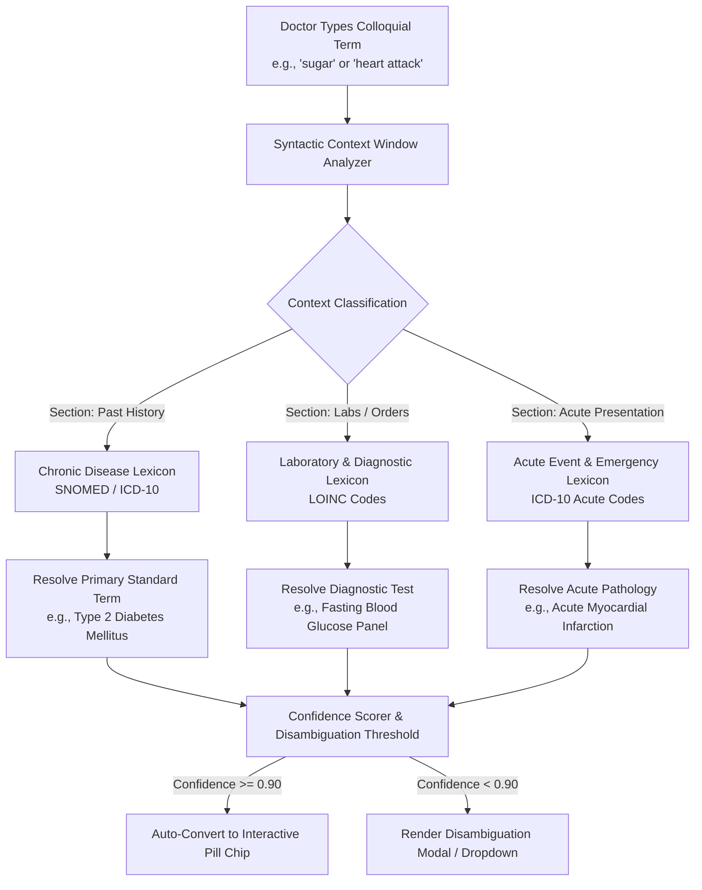

# Universal Medical Nomenclature Standardizer & Vernacular Mapping

**Document ID:** FEAT-NOMENCLATURE-CB-2026-V1  
**Project:** CareBridge India (SwasthyaSetu AI)  
**Scope:** Colloquial & Local Terminology to SNOMED CT, ICD-10, LOINC & ABDM Standard Mapping  
**Version:** 1.0.0 (Production Blueprint)

---

## 1. Problem Statement & Clinical Rationale

In Indian clinical practice, tele-consultations routinely involve doctors recording informal phrases, regional slang, or patient colloquialisms directly into notes:
- Saying/writing *"Patient has sugar"* instead of *"Type 2 Diabetes Mellitus"*.
- Saying/writing *"Patient suffered a heart attack"* instead of distinguishing between *"Acute Myocardial Infarction"* (ischemic tissue necrosis) or *"Cardiac Arrest"* (cessation of mechanical cardiac activity).
- Using regional phrases such as *"Dama"*, *"Gas/Acidity"*, *"Chakkar"*, or *"Piliya"*.

While understandable within a local clinic, unstructured colloquial notes break downstream healthcare interoperability:
1. **ABDM Health Information Exchange (HIE):** EMRs adhering to the Ayushman Bharat Digital Mission mandate coding in **SNOMED CT** and **ICD-10/11**.
2. **Insurance Claims & TPAs:** Claims containing vague terms like "sugar" or "heart attack" are frequently rejected or flagged for audit due to missing diagnostic codes.
3. **Clinical Decision Support (CDS):** Drug-Drug and Drug-Disease interaction engines cannot trigger safety alerts if diabetes is stored as the literal string "sugar".

The **Universal Medical Nomenclature Standardizer** intercepts colloquial and informal medical terms in real time and automatically transforms them into structured, universally accepted clinical codes.

---

## 2. Context-Aware Semantic Disambiguation Pipeline

A naive keyword search fails because words like *"sugar"* mean different things depending on the clinical context:
- In Past Medical History: *"sugar for 5 years"* $\rightarrow$ **Type 2 Diabetes Mellitus**.
- In Laboratory Orders: *"check sugar tomorrow"* $\rightarrow$ **Fasting Blood Glucose Test (LOINC: 1558-6)**.
- In Acute Symptoms: *"felt dizzy, took sweet, low sugar"* $\rightarrow$ **Hypoglycemia (ICD-10: E16.2)**.



---

## 3. Comprehensive Indian Colloquial-to-Universal Mapping Matrix

The table below details the canonical mappings enforced by the CareBridge Nomenclature Standardizer:

| Colloquial / Local Term | Contextual Hint | Universal Standardized Term | Standard Code (ICD-10 / SNOMED / LOINC) | Clinical Category |
| :--- | :--- | :--- | :--- | :--- |
| **Sugar** | History / Chronic | **Type 2 Diabetes Mellitus** | **ICD-10: E11.9** / **SNOMED: 44054006** | Endocrine / Metabolic |
| **Sugar** | Lab order / Fasting | **Fasting Blood Glucose Test** | **LOINC: 1558-6** | Pathology / Investigation |
| **Low Sugar** | Acute episode | **Hypoglycemia, unspecified** | **ICD-10: E16.2** / **SNOMED: 302866003** | Metabolic Emergency |
| **Heart Attack** | Acute / Chest Pain | **Acute Myocardial Infarction (AMI)**| **ICD-10: I21.9** / **SNOMED: 22298006** | Cardiovascular Emergency |
| **Heart Attack** | Sudden collapse / arrest | **Cardiac Arrest, unspecified** | **ICD-10: I46.9** / **SNOMED: 410429000** | Cardiovascular Critical |
| **BP / Tension** | Chronic / Vitals | **Essential (Primary) Hypertension** | **ICD-10: I10** / **SNOMED: 59621000** | Cardiovascular Chronic |
| **Low BP** | Acute / Fainting | **Hypotension, unspecified** | **ICD-10: I95.9** / **SNOMED: 45007003** | Hemodynamic |
| **Gas / Acidity** | Epigastric burning | **Gastroesophageal Reflux Disease (GERD)** | **ICD-10: K21.9** / **SNOMED: 235595009** | Gastroenterology |
| **Gas / Acidity** | Indigestion / Fullness | **Functional Dyspepsia** | **ICD-10: K30** / **SNOMED: 196756002** | Gastroenterology |
| **Dama / Saas Phoolna**| Wheezing / Chronic cough | **Bronchial Asthma, unspecified** | **ICD-10: J45.9** / **SNOMED: 195967001** | Respiratory |
| **Chakkar** | Positional spinning | **Benign Paroxysmal Positional Vertigo** | **ICD-10: H81.1** / **SNOMED: 232288003** | Neuro-Otology |
| **Chakkar / Kamzori** | Lightheadedness / Presyncope | **Presyncope / Dizziness** | **ICD-10: R42** / **SNOMED: 404640003** | General Symptom |
| **Piliya** | Scleral icterus / Dark urine | **Jaundice, unspecified / Viral Hepatitis** | **ICD-10: R17** / **SNOMED: 18165001** | Hepatobiliary |
| **Pathri** | Flank colic / Calculus | **Calculus of Kidney / Ureter** | **ICD-10: N20.0 / N20.1** | Nephrology |
| **Thyroid** | Weight gain / Lethargy | **Hypothyroidism, unspecified** | **ICD-10: E03.9** / **SNOMED: 40930008** | Endocrine |
| **Khooni Bawasir** | Rectal bleeding / Piles | **Hemorrhoids with complications** | **ICD-10: I84.8** / **SNOMED: 73542008** | Colorectal |

---

## 4. UI Interactive Pill Component Specification

When an informal term is identified, the UI renders an **Interactive Nomenclature Pill**:

```
[ Raw typed: "Patient has sugar since 5 yrs" ]
                         │
                         ▼ (Real-time transformation)
"Patient has [ 🏷️ Type 2 Diabetes Mellitus | SNOMED: 44054006 ▾ ] since 5 yrs"
```

### Component States & Behaviors

```typescript
export interface NomenclaturePillProps {
  originalText: string;
  standardizedName: string;
  system: "SNOMED_CT" | "ICD_10" | "LOINC" | "RxNorm";
  code: string;
  confidence: number;
  alternatives: Array<{
    name: string;
    code: string;
    system: string;
  }>;
  onRevert: () => void;
  onSelectAlternative: (alternativeCode: string) => void;
}
```

1. **Hover / Click Popover:**  
   Clicking the dropdown arrow `▾` reveals:
   - *Clinical Definition* (e.g., "E11.9: Non-insulin-dependent diabetes mellitus without complications").
   - *Alternative Concept Matches* (e.g., Switch to *Impaired Glucose Tolerance* or *Type 1 DM*).
   - *1-Click Revert Button:* Restores original raw text (`Ctrl+Z` also supported).
2. **Color Encoding:**
   - **Deep Teal (`hsl(175, 75%, 28%)`):** Confirmed SNOMED/ICD-10 diagnostic term.
   - **Amber (`hsl(38, 92%, 50%)`):** Ambiguous concept requiring doctor choice.
   - **Crimson (`hsl(0, 84%, 60%)`):** Critical acute finding (e.g., Acute Myocardial Infarction, Anaphylaxis).

---

## 5. FHIR R4 Output Serialization

When the encounter is finalized, each standardized pill is mapped directly into an HL7 FHIR R4 **Condition** resource:

```json
{
  "resourceType": "Condition",
  "id": "cond-dm2-ramesh",
  "clinicalStatus": {
    "coding": [
      {
        "system": "http://terminology.hl7.org/CodeSystem/condition-clinical",
        "code": "active",
        "display": "Active"
      }
    ]
  },
  "verificationStatus": {
    "coding": [
      {
        "system": "http://terminology.hl7.org/CodeSystem/condition-ver-status",
        "code": "confirmed",
        "display": "Confirmed"
      }
    ]
  },
  "category": [
    {
      "coding": [
        {
          "system": "http://terminology.hl7.org/CodeSystem/condition-category",
          "code": "encounter-diagnosis",
          "display": "Encounter Diagnosis"
        }
      ]
    }
  ],
  "code": {
    "coding": [
      {
        "system": "http://snomed.info/sct",
        "code": "44054006",
        "display": "Type 2 diabetes mellitus"
      },
      {
        "system": "http://hl7.org/fhir/sid/icd-10",
        "code": "E11.9",
        "display": "Type 2 diabetes mellitus without complications"
      }
    ],
    "text": "Sugar (Colloquial) -> Standardized to Type 2 Diabetes Mellitus"
  },
  "subject": {
    "reference": "Patient/patient_ramesh_gowda",
    "display": "Ramesh Gowda"
  },
  "recorder": {
    "reference": "Practitioner/dr_ananya_sharma",
    "display": "Dr. Ananya Sharma"
  }
}
```
