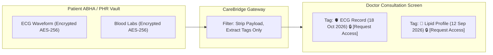
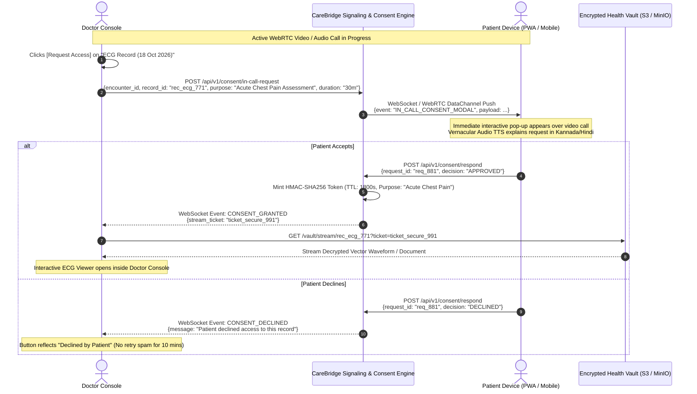

# In-Call ABHA Record Discovery & Dynamic Patient Consent Protocol

**Document ID:** FEAT-INCALL-CONSENT-2026-V1  
**Project:** CareBridge India (SwasthyaSetu AI)  
**Scope:** In-Consultation ABHA Record Tagging, Real-Time In-Call Consent Pop-Up, and Secure Ephemeral Unlocking  
**Version:** 1.0.0 (Production Blueprint)

---

## 1. Zero-Knowledge Record Manifest & Metadata Discovery

Under ABDM (Ayushman Bharat Digital Mission) guidelines, patient health records stored in the Personal Health Record (PHR) / ABHA vault cannot be browsed arbitrarily by a clinician without explicit patient consent.

However, to provide effective tele-care, a physician must know **what diagnostic records exist** (e.g., knowing an ECG or Troponin lab report exists from yesterday).

CareBridge solves this through **Zero-Knowledge Manifest Discovery**:
1. When the patient joins the tele-consultation room, the CareBridge backend queries the patient's linked ABHA Health Information Provider (HIP) registry.
2. The backend retrieves **metadata tags only** (Record Type, Timestamp, Originating Hospital), with **zero medical payload**:
   - `TAG: ECG_RECORD | Date: 18-Oct-2026 | Provider: Hassan District Hospital | Status: Locked 🔒`
   - `TAG: LAB_LIPID | Date: 12-Sep-2026 | Provider: Apollo Clinic | Status: Locked 🔒`
3. These tags are displayed in the Doctor Tele-Console's **"Records with Patient"** drawer. The actual diagnostic traces and PDF files remain strictly encrypted.



---

## 2. In-Call Real-Time Consent Flow

During an active audio/video call, if the doctor needs to inspect an existing diagnostic file (e.g., verifying if current chest pain matches an earlier ECG anomaly):



---

## 3. Patient In-Call Consent Modal Specification

The patient experience during a call must be friction-free, non-intimidating, and accessible to low-literacy users.

### Visual & Vernacular Component Design

```
+-------------------------------------------------------------------------+
|  🔔 DR. ANANYA SHARMA ASKS PERMISSION TO VIEW A RECORD                  |
+-------------------------------------------------------------------------+
|                                                                         |
|  🫀 Document: ECG Trace (Hassan District Hospital, 18 Oct 2026)         |
|  🎯 Purpose:  To evaluate your current chest discomfort                 |
|  ⏱️ Duration: 30 minutes (Active only during this call)                 |
|                                                                         |
|  [ 🔊 Play Audio Explanation in Kannada (ಕನ್ನಡದಲ್ಲಿ ಕೇಳಿ) ]              |
|                                                                         |
|  ---------------------------------------------------------------------  |
|                                                                         |
|   [ ❌ DECLINE (ಬೇಡ) ]                 [ ✅ ALLOW (ಅನುಮತಿಸಿ) ]           |
|   (Dismisses request)                  (Opens scan for Dr. Sharma)      |
|                                                                         |
+-------------------------------------------------------------------------+
```

### Multilingual Audio Prompts (Bhashini TTS Integration)
- **Kannada Prompt:** *"ಡಾಕ್ಟರ್ ಅನನ್ಯಾ ಶರ್ಮಾ ಅವರು ನಿಮ್ಮ ಎದೆಯ ನೋವನ್ನು ಪರೀಕ್ಷಿಸಲು ನಿಮ್ಮ ಇಸಿಜಿ ವರದಿಯನ್ನು 30 ನಿಮಿಷಗಳ ಕಾಲ ನೋಡಲು ಅನುಮತಿ ಕೇಳುತ್ತಿದ್ದಾರೆ. ಅನುಮತಿಸಲು ಹಸಿರು ಬಟನ್ ಒತ್ತಿ, ಬೇಡವೆಂದರೆ ಕೆಂಪು ಬಟನ್ ಒತ್ತಿ."*
- **Hindi Prompt:** *"डॉ. अनन्या शर्मा आपके सीने के दर्द की जांच के लिए आपकी ईसीजी रिपोर्ट को 30 मिनट तक देखने की अनुमति मांग रही हैं। अनुमति देने के लिए हरा बटन दबाएं, अस्वीकार करने के लिए लाल बटन दबाएं।"*

---

## 4. Cryptographic Security & Anti-Leaking Protections

To protect patient privacy and comply with the **Digital Personal Data Protection (DPDP) Act 2023** and **NMC Telemedicine Guidelines**:

1. **No Local Downloading:**  
   The Doctor Tele-Console disables context menu actions, screenshot hooks (where supported by browser APIs), and local file saves for in-call streamed records.
2. **Ephemeral Canvas Rendering:**  
   ECG records are served as raw JSON coordinate vectors (`{ lead: "II", data: [0.12, 0.45, ...] }`) and rendered directly onto an HTML5 `<canvas>` element. At no point is a persistent file saved to the doctor's hard drive.
3. **Session-Bound Revocation:**  
   If the call terminates abruptly or if the patient clicks the persistent **"Revoke Access Now"** floating pill, the Redis TTL key is purged immediately. The Doctor's canvas renders a blank screen within 200ms of revocation.

```json
{
  "consent_token": "hmac_sha256_90fbc21a...",
  "resource_id": "rec_ecg_771",
  "patient_id": "patient_ramesh_gowda",
  "actor_id": "dr_ananya_sharma",
  "encounter_id": "enc_9481",
  "purpose_code": "SNOMED:29857009",
  "purpose_display": "Chest Pain Assessment",
  "granted_at": "2026-10-19T16:45:00Z",
  "expires_at": "2026-10-19T17:15:00Z",
  "revoked": false
}
```
