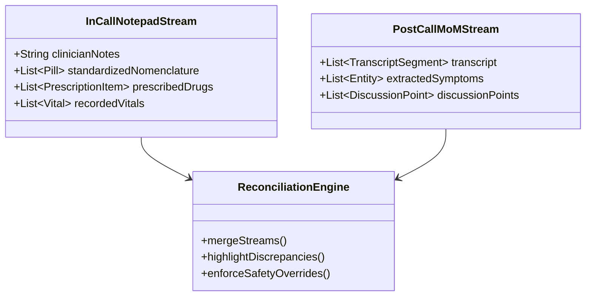
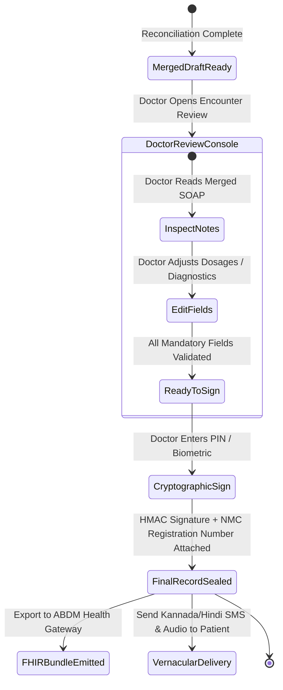

# Post-Consultation Automated Meeting Minutes (MoM) & Ambient Scribe

**Document ID:** FEAT-POSTCALL-MOM-2026-V1  
**Project:** CareBridge India (SwasthyaSetu AI)  
**Scope:** Post-Call Audio Diarization, Clinical Minutes of Meeting (MoM) Synthesis & Dual-Stream Reconciliation  
**Version:** 1.0.0 (Production Blueprint)

---

## 1. Post-Call Processing Pipeline

While the doctor uses the **Real-Time IntelliSense Notepad** during the call to capture immediate clinical impressions, a parallel **Ambient Audio Pipeline** records the two-way consultation dialogue.

Once the call is terminated, the post-consultation engine ingests the audio track, extracts structured **Clinical Minutes of Meeting (MoM)**, and synthesizes an automated draft encounter note.

```mermaid
flowchart TD
    A[WebRTC Call Hang-Up Event\nEncounter Status -> CALL_ENDED] --> B[Dual-Channel Audio Separation\nChannel 0: Doctor | Channel 1: Patient]
    B --> C[Bhashini / Indic-Whisper ASR Worker\nKannada / Hindi / English Code-Switching]
    C --> D[Diarized Clinical Transcript with Timestamps]
    
    D --> E[Clinical NLP Entity Extractor\nNER: Symptoms, Durations, Vitals, Drugs]
    E --> F[Clinical Minutes of Meeting (MoM) Synthesizer]
    F --> G[Draft SOAP Structure Generator]
    
    H[Doctor's Live In-Call Notepad\nSaved at Call Termination] --> I[Dual-Stream Reconciliation Engine]
    G --> I
    
    I --> J[Merged Clinical Encounter Draft]
    J --> K[Doctor Final Verification Console\nNMC Clinician-in-the-Loop Approval]
```

---

## 2. Audio Separation & Vernacular Transcription

### 2.1 Stereo Track Isolation
To eliminate audio overlap (where patient and doctor speak concurrently over cellular delay), CareBridge records consultation audio as **isolated stereo channels**:
- **Left Channel (Track 0):** Clinician microphone capture.
- **Right Channel (Track 1):** Patient microphone capture.

This enables 100% deterministic speaker diarization without relying on error-prone acoustic voiceprint clustering.

### 2.2 Multilingual Code-Switching Pipeline
Indian patients routinely code-switch between their native tongue (Kannada/Hindi) and English medical terms (e.g., *"Nanage two days inda chest pain ide, BP tablet miss aagide"*).

The ingestion worker routes audio through the **Bhashini Indic ASR Engine**, utilizing specialized acoustic language models trained on Indian medical vernacular.

```json
{
  "diarized_transcript": [
    {
      "speaker": "DOCTOR",
      "timestamp_ms": [0, 4200],
      "language": "en-IN",
      "text": "Good morning Ramesh ji, tell me what difficulties you are facing today?"
    },
    {
      "speaker": "PATIENT",
      "timestamp_ms": [4500, 12800],
      "language": "kn-IN",
      "original_vernacular": "ನನಗೆ ಎರಡು ದಿನಗಳಿಂದ ಎದೆ ನೋವು ಬರ್ತಾ ಇದೆ ಡಾಕ್ಟರ್, ಎಡಗೈಗೂ ಹರಡ್ತಾ ಇದೆ. ಶುಗರ್ ಮಾತ್ರೆ ನಿನ್ನೆ ತಗೊಂಡಿಲ್ಲ.",
      "english_translation": "I have been having chest pain for two days doctor, it is also radiating to my left arm. I did not take my sugar tablet yesterday."
    }
  ]
}
```

---

## 3. Clinical Minutes of Meeting (MoM) Structure

The post-consultation engine produces a structured **Minutes of Meeting (MoM)** document designed for clinical quick-review:

```markdown
# CLINICAL MINUTES OF MEETING (MoM) — ENCOUNTER #ENC-9481
**Consultation Date:** 19-Oct-2026, 16:30 IST  
**Doctor:** Dr. Ananya Sharma (KMC #88412)  
**Patient:** Ramesh Gowda (54M, Hassan District)  
**Call Duration:** 14 minutes 32 seconds  

---

### 1. Key Discussion Points & Timeline
- **00:04:15:** Patient reported acute onset retrosternal chest pain for 48 hours, radiating to left shoulder and arm.
- **00:07:30:** Medication non-compliance noted; patient omitted Metformin 500mg dose for past 36 hours.
- **00:09:10:** Doctor requested and received in-call consent to inspect previous Hassan District Hospital ECG (dated 18-Oct-2026).
- **00:11:45:** Doctor advised immediate emergency triage due to persistent ischemic symptoms.

### 2. Clinical Entity Extraction Summary
- **Chief Complaints:** Retrosternal chest pain radiating to left arm (Duration: 2 days).
- **Associated Symptoms:** Diaphoresis, shortness of breath on mild exertion.
- **Relevant Past History:** Type 2 Diabetes Mellitus (5 yrs), prior Myocardial Infarction (2022).
- **Reported Vitals:** Self-reported home BP: 154/96 mmHg.
- **Actions Agreed Upon:** Immediate ECG repeat at nearest Primary Health Centre (PHC), sublingual Sorbitrate SOS if chest pain escalates, and emergency referral.
```

---

## 4. Dual-Stream Reconciliation Engine

The most critical challenge in clinical documentation is reconciling what the doctor **wrote live** in the notepad with what was **spoken in the meeting**.



### Fusion Rules & Discrepancy Highlighting

1. **Doctor Live Note Authority (P0):**
   If the doctor typed `Paracetamol 650mg TDS`, but the ASR recorded *"take 500mg"*, the doctor's written entry takes precedence.
2. **Post-Call Scribe Enrichment (P1):**
   If the patient verbally reported *"my father also died of heart attack at age 50"*, and the doctor didn't write it down, the engine appends this to the **Family History** section flagged with an `[Ambient Scribe Addition]` badge.
3. **Safety Discrepancy Flagging:**
   If the patient mentioned an allergy in the audio (*"I get skin rashes from penicillin"*) that was not documented in the doctor's notepad, the engine marks the field with an **Urgent Safety Warning** (`⚠️ Patient-Reported Penicillin Allergy Detected in Transcript`).

---

## 5. Mandatory Clinician-in-the-Loop Sign-Off Gate

In accordance with the **National Medical Commission (NMC) Telemedicine Practice Guidelines (Registered Medical Practitioner Regulations)**, an automated AI summary or prescription is **legally void** until manually reviewed, edited, and cryptographically signed by the registered practitioner.


