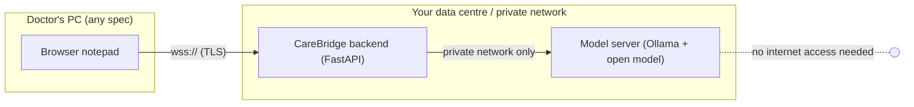

# Tier 3 Sovereign Language-Model Deployment

**Document ID:** FEAT-INTELLISENSE-T3-DEPLOY-2026-V1
**Project:** CareBridge India (SwasthyaSetu AI)
**Scope:** Self-hosted sentence completion for the IntelliSense notepad: modes, hardware, setup, network lockdown, operations
**Version:** 1.0.0

---

## 1. What Tier 3 does

When the doctor pauses at the end of a line, the notepad asks a language model to finish the sentence and shows the answer as grey ghost text. The doctor accepts it with **Tab** or ignores it. Tiers 1–2 (dictionary, shorthand, standardization) always run first. Tier 3 is only asked when they have nothing to offer.

**Sovereignty rule:** the model runs on a server that CareBridge or the hospital controls. No third-party AI API is used, and the backend has no code path that sends note text outside your network.

## 2. Modes

Set `INTELLISENSE_LLM_PROVIDER` in `.env`:

| Value | What runs | Use it for |
|---|---|---|
| *(empty)* | Nothing. Tier 3 is off; the header shows **AI off**. | Any environment without a model server |
| `stub` | Built-in canned suggestions after a short fake delay. No model, no GPU, almost no memory. | Development and demos on low-end machines |
| `local` | Your own [Ollama](https://ollama.com) server running an open model (e.g. Med-Gemma). | Staging and production |

Development on a low-end PC:

```env
INTELLISENSE_LLM_PROVIDER=stub
INTELLISENSE_STUB_DELAY_MS=300
```

The stub answers a few phrase endings, such as "worse during", "radiating to the", "associated with" and "patient advised to". It behaves like a real model for cancellation, caching and the status pill, so the whole flow can be built and tested without a model.

## 3. Production architecture



- Doctors' PCs never run the model. They only send note text to the CareBridge backend, as they already do for Tiers 1–2.
- Only the backend can reach the model server. The model server needs no internet access once the model file has been downloaded.
- Each request carries only the recent note excerpt (up to 120 words) plus patient age and sex. No name, ABHA address or other identifiers.

## 4. Hardware sizing (rough guide, measure on your own hardware)

| Option | Example | Expected time per suggestion | Notes |
|---|---|---|---|
| GPU server | One GPU with 8 GB+ VRAM, 4-bit Med-Gemma 4B | A few hundred ms | Best experience; one GPU serves several concurrent doctors |
| CPU-only server | 8+ cores, 16 GB+ RAM, 4-bit Med-Gemma 4B | Roughly 1–3 s | Workable because suggestions only appear after a pause |
| Tiny CPU model | 0.5–1B parameter model, 4-bit | Fast but lower quality | Only for checking the integration, not for clinical use |

A 4-bit 4B model needs about 3 GB of memory for its weights, plus working memory. Do not run it on a doctor's PC or an 8 GB developer laptop.

## 5. Setting up the model server

1. **Install Ollama** on the model server (Linux recommended).
2. **Get the model.** Check the Ollama library for a Med-Gemma build. If none is available, download a GGUF file of the model you've validated and import it with an Ollama `Modelfile` (`FROM ./model.gguf`, then `ollama create <name> -f Modelfile`).
3. **Make it listen on the private network only**, for example:
   ```bash
   OLLAMA_HOST=10.0.5.20:11434 ollama serve
   ```
4. **Point the backend at it:**
   ```env
   INTELLISENSE_LLM_PROVIDER=local
   INTELLISENSE_LOCAL_URL=http://10.0.5.20:11434
   INTELLISENSE_LOCAL_MODEL=<name from step 2>
   INTELLISENSE_LOCAL_KEEP_ALIVE=30m      # keep the model loaded between suggestions
   INTELLISENSE_LOCAL_NUM_CTX=2048        # small context = less memory, faster
   INTELLISENSE_LOCAL_NUM_THREAD=0        # 0 = auto; set to physical cores on CPU-only servers
   INTELLISENSE_LLM_TIMEOUT_S=6
   INTELLISENSE_LLM_MAX_CONCURRENCY=1     # raise to match what the server handles in parallel
   ```
5. **Restart the backend.** It checks the model server at startup and every 30 s, and loads the model into memory once it's reachable, so the first suggestion isn't slow.

## 6. Network lockdown checklist

- [ ] The model server's firewall allows port 11434 **only** from the backend host(s).
- [ ] The model server has no outbound internet access after the model download.
- [ ] Ollama is bound to a private IP (`OLLAMA_HOST`), never `0.0.0.0` on a public interface.
- [ ] The backend ↔ model server link stays inside the private network or VPN. Add TLS through a reverse proxy if it crosses shared infrastructure.
- [ ] No request or response logging is enabled on the model server or any proxy in front of it. Note text must not be written to disk.

## 7. How wasted model work is kept low

| Mechanism | Effect |
|---|---|
| **Local tiers first** | No model call when the dictionary or shorthand already has a suggestion. |
| **Ask only at boundaries** | Requests are sent only at the end of a line, after a space or `,` / `;`, on a line with 2+ words, never on headings. Ctrl+Space forces one. |
| **Adaptive pause** | The wait before asking is about 3× the doctor's typical gap between keys (0.45–1.2 s), so fast typists aren't interrupted and slow typists don't trigger early calls. |
| **No re-asking** | If the model had nothing to say, it isn't asked again until 3+ new characters are typed. |
| **Cancel on typing** | Any keystroke during a pending request sends `COMPLETION_CANCEL`. The backend closes the stream and Ollama stops generating immediately. |
| **Early stop** | Replies are streamed, and the connection is closed as soon as the sentence ends or the length cap is reached. |
| **Type-along** | If the doctor types the same letters as the suggestion, it stays and shrinks instead of being thrown away. No new request is made. |
| **Prefix caching** | The note excerpt starts at a word position that only moves every 60 words, and the prompt puts stable parts first. The model server can then reuse its cached work on the earlier note, so each request mostly processes the newest words. |
| **Answer cache** | Identical requests are answered from an in-memory cache (RAM only, 256 entries). |

## 8. Protecting the app

| Protection | Behaviour |
|---|---|
| Separate process | The model runs in Ollama, never inside the backend. A model crash can't take the app down. |
| Hard deadline | Every request is cut off after `INTELLISENSE_LLM_TIMEOUT_S`. |
| Concurrency cap | At most `INTELLISENSE_LLM_MAX_CONCURRENCY` requests run at once. Extra ones are skipped, never queued, because a late suggestion is useless. |
| Auto-pause | After 3 consecutive failures, Tier 3 pauses for 60 s and the header pill shows **AI · paused**. |
| Health check | Every 30 s. If the server is unreachable or the model is missing, the pill shows **AI · offline** and no requests are attempted. |
| Fail silent | Any failure means no suggestion. Typing and Tiers 1–2 are never affected. |

## 9. Clinical safety filter

Every completion passes these checks before the doctor sees it:

- Dropped if it contains any number that isn't already in the note (doses, vitals, dates, durations).
- Dropped if the model answers `<none>` (instructed when unsure).
- Cut at the first newline and capped at 15 words / 120 characters.
- Labelled **AI · review before accepting** in the dropdown. Nothing is inserted without the doctor pressing Tab.

## 10. Status reference

`GET /api/v1/intellisense/tier3` (doctor login required) and the header pill report:

| State | Pill | Meaning |
|---|---|---|
| `disabled` | AI off | `INTELLISENSE_LLM_PROVIDER` is empty |
| `starting` | AI on-premise / AI demo | Configured; first health check not finished |
| `ready` | AI on-premise / AI demo | Healthy |
| `paused` | AI · paused | Auto-paused after repeated failures; retries after 60 s |
| `offline` | AI · offline | Model server unreachable or model not installed |

## 11. Go-live verification

1. `GET /api/v1/intellisense/tier3` returns `"state": "ready"`.
2. In the notepad, type `chest pain worse during ` and pause: a grey suggestion appears within the expected time for your hardware.
3. Type a few more letters while a request is pending: the model server's logs show the request ending early.
4. Stop Ollama: within 30 s the pill shows **AI · offline**, and typing and Tiers 1–2 still work.
5. Confirm from a doctor's PC that port 11434 on the model server is **not** reachable.
