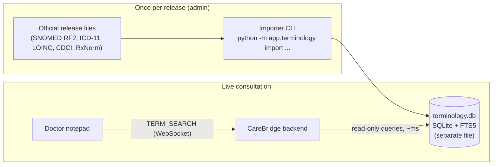

# Clinical Standards Integration Plan

**Document ID:** STD-INTEGRATION-PLAN-2026-V1
**Project:** CareBridge India (SwasthyaSetu AI)
**Source:** CareBridge Standards Integration Guide (terminology, medicines, DDI safety, health-record exchange)
**Status:** Phase 1 built; Phase 2 interaction and allergy checks built with DDInter 2.0 (academic licence). ICD-11, ICD-10 and RxNorm imported; SNOMED CT, LOINC and CDCI importers ready and waiting for licensed downloads (§7)

---

## 1. Goal

Replace the hand-written starter vocabulary (~450 terms in `backend/app/services/clinical_lexicon.py`) with the official clinical standards, so the doctor's notepad, coding, medicine selection and safety checks work across real clinical practice, not just a demo list.

Two constraints shape every decision:

1. **Sovereignty.** No patient or note text leaves CareBridge infrastructure. We use **downloadable official releases hosted on our own servers**, never live third-party lookup APIs at runtime.
2. **Light backend.** No extra always-on services (no Elasticsearch, no Java terminology server). Everything must run on a modest server, and development must work on a low-end laptop.

## 2. Standards: purpose, access and our approach

| Standard | Used for | Access / licence | How we integrate | Status |
|---|---|---|---|---|
| **SNOMED CT** (India release via NRCeS) | Symptoms, findings, disorders, procedures, body sites in the notepad | Free in India as a SNOMED member country; organisation registers as an affiliate through NRCeS / SNOMED MLDS | Import RF2 Snapshot files (concepts, descriptions, language refset) | Importer built; **needs org registration to download** |
| **ICD-11 MMS** (WHO) | Diagnosis classification after doctor review | CC BY-ND 3.0 IGO; free download | Import WHO "Simple Tabulation" file | **Imported (2026-01 release)** |
| **ICD-10** (WHO) + **ICD-10↔11 maps** | Keep existing ICD-10 codes valid; add ICD-11 to every coded diagnosis | Distributed by WHO with ICD-11 | Import WHO mapping tables | **Imported (2026-01 release)** |
| **LOINC** | Lab tests and observations (vitals) | Free with a loinc.org account | Import `Loinc.csv` from the LOINC table release | Importer built; **needs account to download** |
| **CDCI** (NRCeS) | Indian generic and brand medicines | Request through NRCeS national releases | Generic CSV importer with a column map | Importer built; **needs release from NRCeS** |
| **RxNorm** (NLM, prescribable subset) | Medicine identity (ingredients, strengths, forms); fallback until CDCI is loaded | Prescribable subset needs no licence | Import `RXNCONSO.RRF` (ingredients + clinical drugs only, no US brands) | **Imported (10-05-2026 release)** |
| **WHO ATC/DDD** | Drug classes (analytics, class-level safety rules) | WHO licence for the index | Phase 2 | Planned |
| **DDInter 2.0** | Drug–drug interaction knowledge (hackathon) | CC BY-NC-SA 4.0: free for non-commercial use, attribution | Downloaded CSVs → local `interactions` table | **Imported (160,235 pairs)** |
| **DrugBank** / **NRCeS DISB** | Drug–drug interactions for a commercial product | DrugBank: paid commercial licence. DISB: request from NRCeS with CDCI | Same `interactions` table; never a live API | Later, if commercialised |
| **openFDA labels** | Supplementary safety text | Public | Optional, offline snapshot only; US labels, not India-specific | Not planned |
| **HL7 FHIR R4** + **India FHIR IG (ABDM)** | Record structure and exchange | Open | Extend existing FHIR export; validate against ABDM profiles | Phase 3 |

## 3. Architecture: the local terminology store

- **One SQLite file** (`backend/data/terminology.db`), separate from the app database, so it can be rebuilt or replaced without touching patient data.
- **Full-text prefix search** (SQLite FTS5) answers "pneu" → Pneumonia in milliseconds without loading the vocabulary into memory.
- **Read-only at runtime.** The app only reads; imports are an admin step.
- **No network at runtime.** Every lookup is local.

### Tables

| Table | Holds |
|---|---|
| `concepts` | One row per code: system, code, preferred display, category (disorder, finding, drug, lab…), status |
| `terms` | Every searchable name of a concept (preferred term, synonyms, short names), with an FTS5 index |
| `code_maps` | Cross-system maps, starting with ICD-10 → ICD-11 |
| `words` | Distinct vocabulary words with a "sound key", for spell-checking against the full vocabulary |
| `sources` | What was imported: system, release version, file, row counts, date |

## 4. How the notepad uses it

1. **Local first.** The browser's starter vocabulary, shorthand and phrases still answer instantly, offline too.
2. **Terminology search.** When the doctor has typed 3+ letters, the browser also asks the server, debounced and over the existing WebSocket. Results are ranked by match quality, preferred term and **note section**: Plan → medicines, Investigations → LOINC, History/Assessment → disorders.
3. **Accepting a suggestion attaches its code** (SNOMED CT / LOINC / RxNorm / ICD), shown as a chip the doctor can change or revert.
4. **ICD-11 alongside ICD-10.** Any coded diagnosis with an ICD-10 code gets its ICD-11 equivalent from the WHO map. Both are carried into the FHIR `Condition`.
5. **Spell-check against the full vocabulary**, using the same sound-alike matching as today.

The doctor stays in control: nothing is auto-diagnosed or auto-prescribed. Suggestions show their source and code.

## 5. Sizing

| Dataset | Concepts imported | Notes |
|---|---|---|
| ICD-11 MMS 2026-01 | 17,255 | measured |
| ICD-10 (WHO) + maps both ways | 11,243 + 27,055 map rows | measured |
| RxNorm prescribable 2026-10-05 | 20,870 (41,381 names) | measured |
| **Today's database** | **49,368** | **22 MB** |
| SNOMED CT | ~350k concepts, ~1.2M names | load-tested at this size: 28 s import, 257 MB peak memory, 146 MB (expect 250–400 MB with real wording) |
| LOINC | ~100k active codes | estimate: 60–100 MB |

Runtime memory stays small (~10 MB for searching) because SQLite reads from disk with its own page cache. Details in `02_terminology_store_operations.md` §4.

## 6. Phases

### Phase 1: Terminology foundation (this work)
- Terminology store, importers for all standards above, status/search API.
- Notepad server-side search with codes; spell-check on the full vocabulary.
- ICD-11 codes on FHIR Conditions via the WHO map.
- **Done when:** ICD-11, ICD-10 maps and RxNorm are imported. SNOMED CT, LOINC and CDCI importers are proven on official-format samples. Notepad search returns coded results in < 50 ms server time.

### Phase 2: Medicines and safety (interaction and allergy checks built)
- CDCI as the primary medicine catalogue (Indian generics and brands), mapped to RxNorm ingredients where possible.
- **Allergy and contraindication checks** against the patient's recorded allergies (works with existing data).
- **Drug–drug interactions** from DDInter 2.0 (academic licence) in a local `interactions` table; every alert shows its source. The 4 older hard-coded rules now only fill gaps. **Built.**
- **Allergy checks** by drug class against the patient record. **Built.**
- ATC classes for class-level rules (e.g. "any NSAID + warfarin").

### Phase 3: Records and exchange
- FHIR additions: `AllergyIntolerance`, `Observation` (vitals, coded with LOINC), `Composition` for the signed consultation note.
- Validate generated resources against the applicable India FHIR IG (ABDM) profiles before exchange.

## 7. Actions needed from the organisation

| Action | For | Where |
|---|---|---|
| Register as a SNOMED CT affiliate and download the India edition / international release (RF2) | SNOMED CT | NRCeS (nrces.in) and SNOMED MLDS |
| Create a LOINC account and download the LOINC table (CSV) | LOINC | loinc.org/downloads |
| Request the CDCI release | Indian medicine catalogue | nrces.in national releases |
| Done for the hackathon: DDInter 2.0 (non-commercial). Only if commercialised: license DrugBank or request DISB | DDI | DrugBank / NRCeS |
| Confirm attribution text for WHO ICD-11 (CC BY-ND) in the app's About page | Licence compliance | — |

Once files are available, each import is a single command (see `02_terminology_store_operations.md`).

## 8. Risks

| Risk | Mitigation |
|---|---|
| US-centric RxNorm names (acetaminophen vs paracetamol) | Built-in Indian/INN name aliases; CDCI becomes primary in Phase 2 |
| Large SNOMED import on small servers | Import only clinical hierarchies by default; import runs offline, not in the request path |
| Code accuracy in the starter vocabulary | Starter codes are superseded by imported official codes; starter list kept only for shorthand and colloquial terms |
| Licence non-compliance | Imports record source and version; licences tracked in §7 |

## 9. Measured results (development laptop: i5-10310U, 8 GB RAM, no GPU)

- Imports: ICD-11 + ICD-10 + maps ~2 s; RxNorm ~2 s; SNOMED-scale synthetic release 28 s.
- Notepad search at SNOMED scale: median **4.6 ms**, 95th percentile **13 ms** server time (target < 50 ms: met).
- Spell-check against the full vocabulary: 1–36 ms per unseen word, cached afterwards.
- Verified in the browser: "lepto" → Leptospirosis with ICD-11 1B91 + ICD-10 A27.9; "Tab salbut" → Salbutamol (RxNorm 435); diagnosis chips carry both ICD versions into FHIR.
